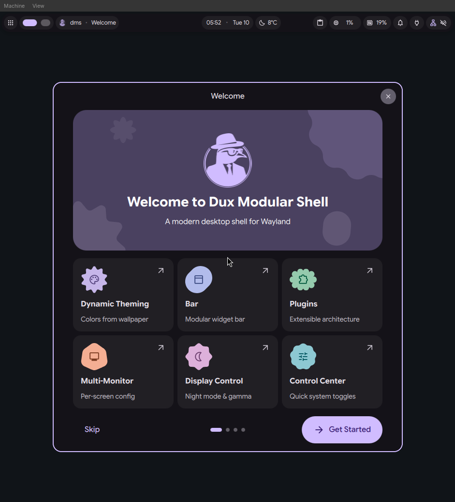

# dux-atomic

[](https://github.com/ultus-net/dux-atomic/actions/workflows/ci.yml)
[](LICENSE)

A planned Fedora bootc developer and gaming workstation for two machines, built on Universal Blue's `base-main`.



The build definition follows the Universal Blue image-template. Every green push to `main` publishes a pullable `ghcr.io/ultus-net/dux-atomic:sha-<commit>` image.

## Status

| Area | State |
| --- | --- |
| Base image | Universal Blue `base-main`, Fedora 45, floating tag while we prototype |
| Generic x86_64 image | Builds, boots to the greeter in a VM, and provisions the desktop on first login |
| Desktop | niri, Dux Modular Shell, Dux Greeter, Ghostty, and an Xfce X11 fallback |
| Applications | First desktop set only. Zed, OpenCode, Steam, Discord, Spotify, Bitwarden, Obsidian, Zen Browser, and Lutris are planned and not installed |
| NVIDIA variant | Planned, not built |
| Configuration | The existing [dotfiles repository](https://github.com/ultus-net/dotfiles) remains authoritative |
| Publishing | CI signs every published digest with cosign keyless OIDC and attests the SBOM. `:latest` moves only on a manual promotion |
| Rollback, agent isolation, snapshots | Planned: explicit rollback, project-scoped rootless agent containers, and local home snapshots. The image relies on the base's `bootc` update and rollback mechanics and ships no agent sandbox |

## Quick start

```bash
just ci-local
```

`just ci-local` runs the static gate, builds the image, and lints it. `just disk` and `just boot` take it into a VM. `just disk` needs the image in rootful podman storage; [Testing](docs/testing.md) has the load step, and [Build](docs/build.md) covers the build inputs.

## What's in the image

| Component | What it is |
| --- | --- |
| niri | Scrollable-tiling Wayland compositor |
| Dux Modular Shell | Desktop shell with launcher, status bar, and lock screen |
| Dux Greeter | Login greeter, with the niri session preselected |
| Ghostty | Terminal |
| Xfce | X11 fallback session |

The image ships no interactive user. A real install creates the operator account itself.

## Documentation

- [Build](docs/build.md)
- [First login](docs/first-login.md)
- [Testing](docs/testing.md)
- [CI and publishing](docs/ci.md)
- [Known gaps before promotion](docs/known-gaps.md)
- [Approved design](docs/superpowers/specs/2026-11-09-dux-atomic-design.md)
