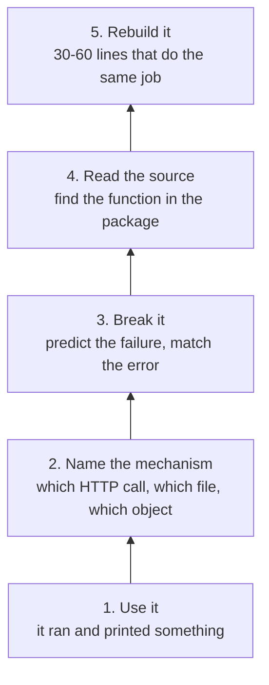
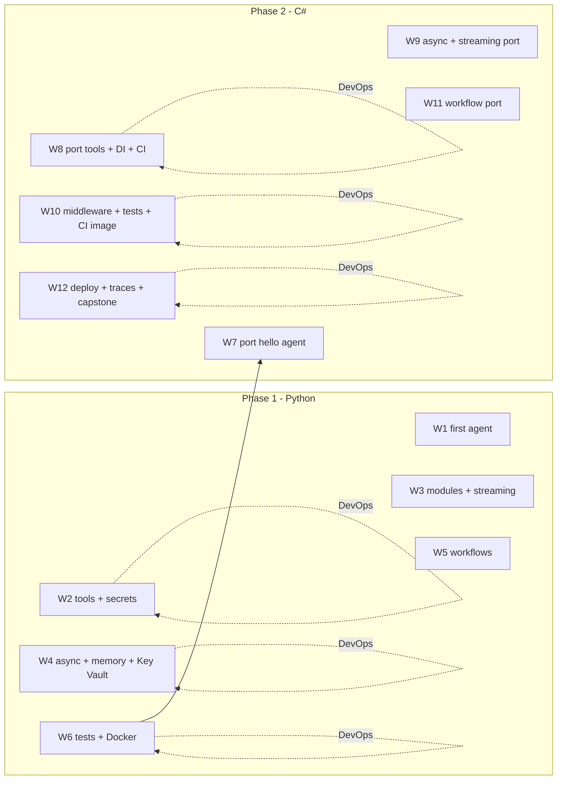

# Microsoft Agent Framework: a 12-stage depth plan

For an engineer with strong design intuition and no programming experience,
working at a machine all day, learning by going one layer below the
abstraction they already understand.

Stage 1-6 teach Python by building CLI agents.
Stage 7-12 teach C# by rebuilding the same agents in .NET.
Every second stage adds one small DevOps milestone.

Stages are numbered, not dated. A stage ends at its gate, not on a Monday.

---

## 1. Read this before you start

### The one rule that keeps this honest

Never copy code from a blog post, video, or AI chat into your project.

Every code snippet comes from one of two places:

1. The official sample repository, at the version you have pinned.
2. Code you wrote, after you understood line by line what it does.

The Microsoft Agent Framework (MAF) is young and still changing shape.
Class names move between releases (`Agent` and `ChatAgent` have swapped
places more than once, and the OpenAI client family has grown
`OpenAIChatClient`, `AzureOpenAIClient`, and `FoundryChatClient`). A
tutorial written four months ago may not import at all.

Practical consequence: pin your versions, and read the samples that ship
with the version you pinned. The samples are the ground truth.

```bash
# Python: pin in pyproject.toml, never "agent-framework" bare
agent-framework = "==<version you verified>"

# .NET: pin centrally, see stage 8
# Directory.Packages.props holds <PackageVersion Include="Microsoft.Agents.AI" Version="..." />
```

### How this actually fits a working day

You are at a keyboard all day, already running agents. So schedule nothing.
Attach the learning to moments you already have: while an agent run streams,
while CI runs, while a build finishes, while you wait for a review. Each is
a slot of 10 to 40 minutes with a natural end.

A sitting is one such slot with one goal, one command, and one written result.
If a sitting has two goals, it is two sittings, and you will not finish
either. That is why every rung below is sized to a single slot.

That changes the shape of the plan, not just its calendar.

| A normal course | Your version |
| --- | --- |
| Calendar weeks | Stages advance on a gate, never on a date |
| One long evening session | Many short sittings, each resumable in 60 seconds |
| Read the chapter, then build | Build first, read the mechanism when it bites |
| Homework | Work-adjacent, interruptible, zero setup cost |

Because a sitting can be interrupted mid-thought, every stage keeps one
`STATE.md` at the top of the repo.

```markdown
stage: 04
rung: 3 (break it)
last command: uv run python -m shopping_agent
next action: raise the fake 429 in retry_once(), compare logs
open question: does the thread survive a process restart?
```

Resume by reading four lines. Never by re-reading this plan. A stage you
cannot resume in a minute is a stage you will quietly abandon, and quiet
abandonment is the actual failure mode here, not lack of ability.

Pace: 4 to 6 sittings a day at 20 to 30 minutes is 10 to 15 hours a week.
A stage therefore takes 2 to 4 days, not 7. Do not shorten the gate because
you are moving fast. If a gate takes three days, that is the plan working.

### The depth ladder

You already reason about systems. The missing layer is tactile: what the
framework does on your behalf, and what it looks like when that breaks.
Every stage climbs the same five rungs on its one headline construct.



Climb upward in order. A stage is done when you have reached rung 5 at least
once for its headline construct. Rungs 1 to 3 are cheap and fit a 15 minute
slot. Rung 4 needs a real editor window. Rung 5 needs a clear hour.

Rung 5 is the rung that forces depth, so it is specified per stage. Nothing
else in this plan is as load-bearing as this table.

| Stage | Rebuild exercise | Size |
| --- | --- | --- |
| 1 | POST to the model endpoint with `requests` and your own `az` token. No framework. | ~40 lines |
| 2 | Hand-roll the tool loop: read the tool call, dispatch, append the result, resend. | ~60 lines |
| 3 | Parse the SSE stream yourself, print deltas as they arrive. | ~40 lines |
| 4 | Drop the framework thread. Keep messages in a list, append both sides, resend. | ~30 lines |
| 5 | Write an executor: nodes as a dict of functions, edges as a dict, loop to a terminal node. | ~40 lines |
| 6 | Write a fake chat client that returns a canned tool call, then use it in every test. | ~50 lines |
| 7 | Stage 1 again, in C# with `HttpClient`. | ~50 lines |
| 8 | Delete the DI container. Hand-wire the graph in `Main`. Restore it, list what it bought. | ~30 lines |
| 9 | Write an `IChatClient` decorator that logs and retries. | ~40 lines |
| 10 | Write by hand the middleware the framework hands you. | ~40 lines |
| 11 | Port your stage-5 executor to C#. | ~50 lines |
| 12 | Read raw OTel spans as JSON before you look at any trace UI. | reading |

If a rebuild runs past two sittings, drop to rung 3 on that construct and
move on. Overreach at rung 5 produces copy-paste, and copy-paste is the one
outcome that makes this entire plan worthless.

### Two rules that protect all of it

**An agent may explain, never author.** The lab code is typed by you,
including the boring parts.

You run agents for a living, so the temptation is constant and the cost is
invisible. You get working code and zero depth. If you catch yourself
accepting a 60-line patch you could not have written, delete it and rebuild
it at rung 5.

**Never experiment in the repo your agents are building.** `agent-lab` is a
separate repo, or at minimum a worktree on its own branch. Half-finished
learning experiments in a live project cost more than they teach, and you
will not notice until a review.

### What "done" means per stage

A stage is done when all five are true:

- The mini-project runs from a clean checkout, or a fresh container.
- Its acceptance criteria are ticked, and you can point at the output.
- You reached rung 5 once for the headline construct, and the rebuild code
  is committed beside the framework version.
- The code reading exercise produced its one-page artifact.
- `STATE.md` says the stage is closed, with one line on what surprised you.

No demo, no tick. "It works on my laptop" is not evidence, and neither is
"I read the docs and understood it".

---

## 2. Ground truth: what you are actually installing

These are the real package names and sample paths, verified against the
official repository.

| Purpose | Python | .NET |
| --- | --- | --- |
| Core framework | `pip install agent-framework` | `dotnet add package Microsoft.Agents.AI` |
| Foundry / Azure OpenAI client | `agent_framework.openai`, `agent_framework.foundry` | `Microsoft.Agents.AI.Foundry` + `Azure.AI.Projects` |
| Identity | `azure-identity` (`AzureCliCredential`) | `Azure.Identity` (`AzureCliCredential`, `DefaultAzureCredential`) |
| Function tools | plain Python functions with type hints and docstrings | `AIFunctionFactory.Create(...)` + `[Description]` |
| Tool parameter metadata | `typing.Annotated` + `pydantic.Field` | `[Description]` on parameters |
| Observability | `agent_framework.observability.configure_otel_providers(...)` | `Microsoft.Extensions.AI` telemetry + OpenTelemetry exporter |
| Chat abstraction (the seam) | chat client object passed to an agent | `IChatClient` interface |

The sample tree you will read from for all twelve stages. Clone it once and
keep it open in a second editor window.

```text
agent-framework/
  python/samples/
    01-get-started/       01_hello_agent.py, 02_add_tools.py, 03_multi_turn.py,
                          04_memory.py, 05a/05b/05c workflows, 07_hosting.py
    02-agents/            tools, middleware, observability, providers, mcp, ...
    03-workflows/         _start-here, agents, declarative, human-in-the-loop, ...
    04-hosting/           container, azure_functions, foundry-hosted-agents, ...
  dotnet/samples/
    01-get-started/       01_hello_agent/, 02_add_tools/, 03_multi_turn/,
                          04_memory/, 05_first_workflow/, 06_host_your_agent/
    02-agents/  03-workflows/  04-hosting/
```

The Python and .NET sample trees mirror each other folder by folder. That
mirror is your Phase 2 cheat sheet: for any concept, the same numbered
sample exists in both languages.

```bash
git clone https://github.com/microsoft/agent-framework.git ~/src/agent-framework
cd ~/src/agent-framework && git log -1 --format='%H %ci'
```

Record that commit hash in your journal. When a sample does not match the
docs, you check whether the repo moved.

---

## 3. Your repository layout

One repo, two language folders, one folder per stage. The numeric prefix in
every folder name is the stage number, so sorting the tree sorts the course.
Small, boring, easy to find things in six months.

```text
agent-lab/
  README.md                 # what this repo is, how to run stage N
  docs/journal.md           # 5 lines per stage
  docs/reading-notes/       # one file per code reading exercise
  py/
    pyproject.toml
    s01_hello_agent/
    s02_file_triage/
    ...
  dotnet/
    Directory.Packages.props
    S07HelloAgent/
    S08FileTriage/
    ...
```

Why one folder per stage rather than one evolving app: in stage 11 you will
want to diff your stage-2 tool definition against your stage-10 one.
Keeping stages separate makes that diff readable, and it stops a broken
stage from blocking the next one.

---

## 4. The map



Reading left to right is the storyline. Every C# stage rebuilds the Python
stage five stages earlier. The gap is deliberate: you meet each concept
twice, once in each language, with a rest in between.

---

## 5. Stage 0: setup (do this before stage 1, about 4 hours)

You are not learning anything here. You are removing every reason to be
blocked later.

**Install**

- Python 3.12 or newer, plus `uv` (`curl -LsSf https://astral.sh/uv/install.sh | sh`).
- .NET 9 or 10 SDK, now, not in stage 7.
- Git, VS Code with the Python and C# Dev Kit extensions.
- Azure CLI, then `az login`.
- Docker Engine or Docker Desktop, then `docker run hello-world`.

**Create the Azure side**

- A Foundry project with one model deployment. Pick a small, cheap model.
  You do not need a frontier model to learn tool calling.
- Note two values: the project endpoint and the deployment (model) name.
  These go in your environment, never in source.

**Acceptance criteria**

- [ ] `python --version`, `dotnet --version`, `docker --version`, `az account show` all succeed.
- [ ] `uv run python -c "import agent_framework; print(agent_framework.__version__)"` prints a version.
- [ ] `python/samples/01-get-started/01_hello_agent.py` produces text on your machine, from `az login` credentials only.
- [ ] You can say out loud which Azure subscription you are pointed at.

If the sample does not run, stop and fix this before stage 1. Every later
stage assumes it works, and debugging setup inside a lesson is miserable.

**Cost guardrail, do it now not later**

- [ ] A budget alert on the subscription at a small monthly amount, wired to your email.
- [ ] You know how to delete the deployment if you need to.

---

## 6. Phase 1, stages 1-6: Python through agents

### Stage 1 - Your first agent, and the smallest possible Python program

**Core language concepts**

- Running a file: `python s01/hello.py`, and what the interpreter does.
- Variables and assignment. `str`, `int`, `float`, `bool`. No type declarations.
- `print()` and f-strings: `f"Topic: {topic}"`.
- Defining a function with `def`, calling it, returning a value.
- `import` and why the standard library is free capability.
- `sys.argv` so your program takes input from the shell.

**Agent framework concepts**

- The shape of an agent: a chat client (connection and credentials) plus
  instructions (the standing system prompt).
- Instructions versus a prompt. Instructions persist for the whole run.
  A prompt is one turn.
- `asyncio.run(main())` as the entry point. You do not need to understand
  async yet. You need to recognise the pattern, because every sample uses it.
- Credential choice: `AzureCliCredential` for local development. It borrows
  your `az login` identity, so no key lives on disk.

**Mini-project: `hello-agent` (one file, about 40 lines)**

A CLI that takes a topic argument and prints a short piece of prose about it.

```bash
python s01/hello.py "Azure Key Vault"
python s01/hello.py            # must fail helpfully, not with a traceback
```

Acceptance criteria:

- [ ] Runs from a fresh virtual environment you created yourself, not a system Python.
- [ ] `python s01/hello.py` with no argument prints a usage line and exits with code 1 (check `echo $?`).
- [ ] Endpoint and model name come from environment variables. `grep -r "https://" s01/` returns nothing.
- [ ] You can change the instructions and predict the change in output before you run it. Do it once, and write down whether you were right.

**Code reading exercise**

Read `python/samples/01-get-started/01_hello_agent.py` and
`dotnet/samples/01-get-started/01_hello_agent/Program.cs` side by side.

Write `docs/reading-notes/w01.md` answering five questions:

1. Which line creates the connection, and which line shapes the personality?
2. Where does the credential come from, and what would change in CI?
3. What is `await` doing, and what would happen without it?
4. Which lines are Python-specific and which are framework-specific?
5. If the model name were wrong, which error would you see first?

That fifth question is the important one. Predicting failure modes is most
of debugging.

---

### Stage 2 - Tools, and the first DevOps milestone

**Core language concepts**

- `list` and `dict`, indexing, `.get()`, iteration with `for x in items`.
- `for` and `while`. `if` / `elif` / `else`.
- Truthiness: empty list, empty string, `None`. This bites everyone.
- Functions with parameters and defaults. Keyword arguments.
- `try` / `except` and raising your own error with `raise ValueError(...)`.
- `if __name__ == "__main__":` and why samples use it.
- `pathlib.Path` instead of string concatenation for file paths.

**Agent framework concepts**

- A tool is just a function. The model decides to call it based on the
  function's name, docstring, and type hints.
- That means metadata is prompt engineering. A vague docstring produces
  wrong tool calls, and no amount of model quality fixes it.
- `Annotated[str, Field(description="...")]` for parameter descriptions.
- The tool-call round trip: model emits a call, your code runs the function,
  the result goes back to the model, the model answers. Three round trips
  are normal for one question.
- Never let a tool raise into the model loop. Return an error *string* the
  model can read and recover from.

**Mini-project: `file-triage-agent`**

Two tools plus a CLI.

```text
list_files(path)          -> newline-separated file names, or an error string
count_lines(path)         -> integer line count, or an error string
```

Then ask: "Which of these files is the longest, and by how much?"

Acceptance criteria:

- [ ] A run visibly triggers both tools in order (log each call to stderr).
- [ ] Asking about a path that does not exist produces a sentence, not a traceback.
- [ ] Asking something unrelated to files produces no tool call at all. Wrong tool use on unrelated prompts is a real bug and easy to miss.
- [ ] Each tool has one `pytest` test: one happy path, one bad path. `pytest -q` is green.
- [ ] `list_files` refuses to escape the directory it was given (try `../..`).

**DevOps milestone 2: secrets, identity, and cost**

This is the milestone that stops you being a liability in an Azure shop.

- [ ] `.gitignore` contains `.env`, `*.env`, `.venv/`. Prove it: create `.env`, run `git status`, see nothing.
- [ ] `.env.example` lists the variable names with dummy values. That file is committed. Real values never are.
- [ ] Read secrets with `os.environ[...]` and fail loudly when one is missing. Do not use `os.environ.get("X", "")`, because a blank endpoint fails far from the cause.
- [ ] Run `az account show --query "{sub:name,user:user.name}" -o table` and save the output in your journal. You will need to know who you were when a permission error appears.
- [ ] Verify no secret ever reached history: `git log -p | grep -iE "api[_-]?key|secret|password" | head`.
- [ ] Set the budget alert if stage 0 did not stick.

**Code reading exercise**

Read `02_add_tools.py` in `python/samples/01-get-started/`. Write
`docs/reading-notes/w02.md` with a numbered trace of one tool call: every
line that executes, from the `agent.run(...)` call to the tool returning,
and back to the final printed answer. Then answer: which single change
would make the model stop choosing that tool?

---

### Stage 3 - Structure, packages, and streaming

**Core language concepts**

- Modules and packages: one file is a module, a folder with `__init__.py` is a package.
- `from x import y` versus `import x`. Absolute imports only.
- `pyproject.toml`: project metadata, dependencies, tool config. This is
  the Python equivalent of a `.csproj`, and you will meet that in stage 8.
- Type hints as documentation: `def f(path: str) -> int:`. They do not
  enforce anything at runtime, but your editor and the model both read them.
- Dataclasses for grouping related fields. `@dataclass`.
- `logging` instead of `print`, with a level.
- `python -m mypackage` versus `python file.py`.

**Agent framework concepts**

- Streaming: `stream=True`, then iterate. Tokens arrive as events instead
  of one finished block. This is the difference between a demo and a product.
- Separating agent construction from agent invocation. One factory function
  that builds the agent, one function that runs a turn.
- Tool modules versus the agent module. Tools get their own file so they
  can be tested without a model.

**Mini-project: `notes-agent` restructured**

Split stage 2's single file into a package.

```text
s03_notes_agent/
  __init__.py
  main.py            # argv parsing, entry point
  agent.py           # build_agent()
  tools/
    __init__.py
    files.py         # list_files, count_lines, search_text
  config.py          # reads env, validates, raises if missing
```

Add a third tool: `search_text(path, needle)` returning matching lines with
numbers.

Acceptance criteria:

- [ ] Three or more modules, and `python -m s03_notes_agent.main ...` works from the `py/` root.
- [ ] Streaming is visible: words appear progressively, proven by a screen recording or a timestamped log.
- [ ] `config.py` raises a specific error naming the missing variable.
- [ ] Tool functions are imported by tests with no model client anywhere in the import path. Check with `python -c "from s03_notes_agent.tools import files"`.
- [ ] `ruff check .` is clean.

**Code reading exercise**

Read the `pyproject.toml` of the `agent-framework` Python packages (start at
`python/packages/core/pyproject.toml`) and answer: what are the optional
dependency groups, which one do you actually use, and what happens at
install time if you pick the wrong one? Then read
`python/samples/02-agents/tools/` and list every distinct way a tool can be
provided. Save as `docs/reading-notes/w03.md`.

The lesson here: dependency groups are a real source of
"it works for my teammate" bugs.

---

### Stage 4 - Async, memory, and Key Vault

**Core language concepts**

- `async def` and `await`. An `await` point is where your program can do
  something else. Nothing more mysterious than that.
- `asyncio.run()` as the only entry point. Do not call `asyncio.run` inside
  an already-running loop.
- `asyncio.gather(...)` to run independent calls at once, and why that is
  faster than sequential when each call is network-bound.
- `asyncio.sleep` versus `time.sleep` inside async code. The blocking one
  stalls everything.
- `try` / `except Exception as e` around network calls, plus a `finally`.
- Keyboard interrupt handling so Ctrl-C exits with a message.
- Simple retry with a counter and a backoff sleep.

**Agent framework concepts**

- Conversation state lives in a thread object, not in your variables. Ask
  the agent for a new thread, pass it into `run(...)`, and the history
  travels with it. (Check the exact method name in `03_multi_turn.py` at
  your pinned version, it has changed.)
- Retry policy for transient model failures. A 429 is normal and should not
  crash your CLI.
- Tool failures are model-visible. Transport failures are yours to handle.
  Confusing the two produces silent loops.

**Mini-project: `shopping-list-agent` with memory**

A single process where you chat in a loop.

```text
> add milk
Added. Your list: milk
> add bread
Added. Your list: milk, bread
> what is on my list?
Your list has 2 items: milk, bread
```

State lives in a plain file (`list.json`) and in the conversation thread.

Acceptance criteria:

- [ ] Subsequent turns remember earlier ones without you resending history.
- [ ] `Ctrl-C` prints "bye" and exits with code 0. Verified by hand.
- [ ] Two tool calls that do not depend on each other run through `asyncio.gather` in one tool, with a log showing both started before either finished.
- [ ] A simulated 429 (raise it artificially once) retries once and then succeeds. Log one line per attempt.
- [ ] No blocking `time.sleep` or `requests` call anywhere in the async path.

**DevOps milestone 4: Key Vault instead of `.env`**

- [ ] Create a Key Vault. Add two secrets: the endpoint and the model name
  (yes, the model name is not sensitive, do it anyway to practise).
- [ ] Read them at startup with `azure-keyvault-secrets` and
  `DefaultAzureCredential`, falling back to `AzureCliCredential` locally.
- [ ] Grant yourself only the secret-read permission you need. If you cannot
  read a secret, debug the role assignment from the error, and write the fix
  in your journal. This is the single most common Azure blocker for
  newcomers.
- [ ] Cache the values in memory after the first read. Do not call Key Vault
  per request.
- [ ] Delete `.env` from your working tree and confirm the app still starts.

**Code reading exercise**

Read `03_multi_turn.py` and `04_memory.py` in `python/samples/01-get-started/`.
Answer in `docs/reading-notes/w04.md`: where is conversation state stored,
what is in the object you pass between turns, and what breaks if you create
a fresh thread per turn? Then find where the Azure credential object is
constructed in the OpenAI client package, and explain in two sentences why
that is a good seam.

---

### Stage 5 - Workflows: agents as a graph

**Core language concepts**

- Classes: `class X:`, `__init__`, `self`, attributes, methods. This is
  mostly so you can read other people's code. Write functions by default.
- `@dataclass` versus a full class. Know when each is right.
- Dictionaries and lists as nested structures, and reading them without
  three lines of `if key in d`.
- Reading and writing JSON: `json.loads`, `json.dumps(indent=2)`.
- Iterating over a stream of events and filtering by type.

**Agent framework concepts**

- A workflow is a graph. Nodes do work, edges decide what runs next.
- Two ways to author one: declarative YAML, and imperative code with
  executors and edges. Learn the YAML first, because it is readable, then
  read the imperative version.
- `WorkflowFactory`, registering an agent by name, creating a workflow from
  a YAML path, running with `stream=True` and iterating events.
- Why workflows exist at all: predictability. A single agent chooses its own
  path. A graph fixes the path and lets each node be tested alone.
- Event streaming is how you observe a graph. Print the event type per line
  until the shape is obvious.

**Mini-project: `triage-workflow`**

Three nodes, one branch.

```text
input -> classify (bug | question | billing)
         bug      -> bug_specialist
         question -> docs_specialist
         billing  -> human_handoff (prints a canned message, no model call)
      -> summarize (one paragraph, cites which path was taken)
```

Acceptance criteria:

- [ ] The graph is defined in a YAML file committed to the repo, plus a loader.
- [ ] Three sample inputs route to three different nodes, proven by the logged path.
- [ ] Each node logs one line with its name and input length.
- [ ] `human_handoff` makes zero model calls. Verify by running with no credentials and watching it still succeed for a billing input.
- [ ] The streamed events, printed in order, match the path you drew on paper first.

Draw the graph on paper before you write YAML. If your drawing and the YAML
disagree, the YAML is wrong.

**Code reading exercise**

Read `python/samples/03-workflows/_start-here/`, then one declarative sample
under `python/samples/03-workflows/declarative/`. Produce
`docs/reading-notes/w05.md` with a table: YAML key -> Python object it
becomes -> what you would change to add a fourth branch. Then find the same
sample in `dotnet/samples/03-workflows/` and note every place the two
languages express the same idea differently. That comparison is stage 11
preparation.

---

### Stage 6 - Tests, packaging, container

**Core language concepts**

- `pytest`: test functions, `assert`, `pytest.raises`.
- Fixtures with `@pytest.fixture`, and `tmp_path` for filesystem tests.
- Monkeypatching to replace a network client with a fake, so tests run offline.
- `conftest.py` for shared fixtures.
- Dependency injection without a framework: pass the client in as a
  parameter. This is the whole concept, and it is why your tests can be fast.
- Packaging: a `README.md` that a stranger can follow, and a `Dockerfile`.

**Agent framework concepts**

- You cannot unit test model output. You can unit test everything around it:
  tool functions, routing logic, config validation, error paths.
- Test the seam, not the model. Inject a fake chat client that returns a
  fixed tool call, then assert your code ran the right function.
- Middleware for cross-cutting behaviour: logging, timing, correlation ids.
  A middleware subclass with an async `process(context, call_next)` method.
- One correlation id per turn, logged with every line. This is not optional
  polish. Without it you cannot debug a multi-turn run.

**Mini-project: `agent-lab-py` v1.0**

Harden `notes-agent` into something you would show a colleague.

Acceptance criteria:

- [ ] `pytest -q` passes with the network unplugged. If a test needs Azure, it is marked and skipped by default.
- [ ] At least 8 tests: 3 tool tests, 2 config tests, 2 routing/error tests, 1 middleware test.
- [ ] A logging middleware prefixes every line with a correlation id, and one run shows the same id on all lines.
- [ ] `README.md` has: what it does, prerequisites, the exact commands, one example session, known limitations. Someone else follows it without asking you a question.
- [ ] `ruff check .` clean, `ruff format --check .` clean.
- [ ] Tag it `v1.0-py` in git.

**DevOps milestone 6: containerise it**

- [ ] Multi-stage Dockerfile: build stage installs dependencies, runtime
  stage copies only what is needed.
- [ ] Runs as a non-root user. Add the `USER` line and prove it with `docker run --rm image whoami`.
- [ ] Base image pinned by tag, not `latest`. Note the tag in the README.
- [ ] `docker run --env-file .env -it <image>` works with no Python on the host.
- [ ] Image size recorded in the README. You will compare this to the .NET image in stage 12, and the comparison is genuinely interesting.
- [ ] `.dockerignore` excludes `.venv`, `.git`, `tests/`.

**Code reading exercise: your first real team repo**

Pick one Python repository your team actually runs. Use this protocol, and
write `docs/reading-notes/w06-team.md`:

1. **Entry point.** Find what starts it. `Dockerfile` `CMD`, a `main.py`, or
   a function decorator. Write the file and line.
2. **Config.** Where do environment variables and secrets enter? One
   paragraph. If the answer is "everywhere", write that down, because it is
   a finding worth raising.
3. **The model call.** Find the one place that talks to a model or external
   API. Name it.
4. **The seam.** What would you swap to test this without network access?
5. **Two questions you could not answer.** Bring them to your next 1:1.
   This is the highest-value output of the exercise.

Do not try to understand the whole repo. Five answers, one page.

---

### Phase 1 gate

You are ready for C# when you can do all of these without help:

- [ ] Write a CLI agent with two tools, from an empty folder, in under an hour.
- [ ] Add a third tool, and a test for it, without touching the agent file.
- [ ] Explain why a tool's docstring changes model behaviour.
- [ ] Read a Python file in your team's repo and state what it does in three sentences.
- [ ] Build and run the container, and read its logs to find a failed tool call.

---

## 7. Phase 2, stages 7-12: the same ideas in C#

You are not learning a new subject. You are learning a new syntax for a
subject you already know. Whenever a stage feels hard, open the Python version
beside it and diff the two in your head.

### Stage 7 - Types, projects, and the port of stage 1

**Core language concepts**

- `dotnet new console`, `dotnet run`, `dotnet build`. The `.csproj` file is
  the project file, and it is the C# answer to `pyproject.toml`.
- Top-level statements: the entry file without a `Main` wrapper.
- Types are real here. `string`, `int`, `double`, `bool`, `var`.
- `$"Topic: {topic}"` string interpolation, and `@""` verbatim strings.
- Methods: `static string Greet(string name)`, return types, expression bodies.
- `string?` nullable references, and why the compiler warns. Treat warnings as errors from day one: `<TreatWarningsAsErrors>true</TreatWarningsAsErrors>`.
- `args`, and `Environment.GetEnvironmentVariable(...) ?? throw ...`.

**Agent framework concepts**

- `Microsoft.Agents.AI` gives you `AIAgent`. One interface, many providers.
- `AIProjectClient(...).AsAIAgent(model:, instructions:, tools:)` is the
  Foundry route. `ChatClient.AsAIAgent(...)` is the chat-completions route.
- `await agent.RunAsync(prompt)` versus `await foreach (var update in agent.RunStreamingAsync(prompt))`.
- `AzureCliCredential` locally, `ManagedIdentityCredential` in Azure. Note
  the warning in the official sample about `DefaultAzureCredential` probing
  in production.

**Mini-project: `S07HelloAgent`**

The stage 1 agent, in C#. Same behaviour, same argument handling, same
failure on a missing argument.

Acceptance criteria:

- [ ] `dotnet run --project dotnet/S07HelloAgent -- "Azure Key Vault"` prints prose.
- [ ] Missing argument prints usage and returns exit code 1 (`echo $?`).
- [ ] Builds with zero warnings and warnings-as-errors enabled.
- [ ] Endpoint and model read from configuration, not literals.
- [ ] A one-paragraph note in `docs/journal.md`: the three things that
  surprised you most coming from Python. Usually it is types, the entry
  point, and the build step.

**Code reading exercise**

Read `dotnet/samples/01-get-started/02_add_tools/Program.cs` next to
`python/samples/01-get-started/02_add_tools.py`. Write a two-column table in
`docs/reading-notes/w07.md`: Python line meaning, C# line meaning. Then
answer: what does `AIFunctionFactory.Create(GetWeather)` need from
`GetWeather` in order to work, and why does `[Description]` exist rather
than a comment?

---

### Stage 8 - Classes, DI, and the first CI pipeline

**Core language concepts**

- Classes: fields, properties, constructors, `this`.
- Interfaces: `IFileTools` and one implementation. This is the seam you get
  for free instead of building it by hand as in stage 6.
- Records for data: `record ToolResult(bool Ok, string Message);`
- Collections: `List<T>`, `Dictionary<string, T>`, `IReadOnlyList<T>`.
- LINQ basics: `.Where(...)`, `.Select(...)`, `.Any(...)`. Read it, do not
  overuse it yet.
- `async Task<T>` as a return type.
- NuGet: `dotnet add package`, `dotnet list package --outdated`.
- Central package management: `Directory.Packages.props`. One version, one
  place. This is how an Azure team keeps 30 repos consistent.

**Agent framework concepts**

- Registering tools that are instance methods. `AIFunctionFactory.Create(tools.CountLines)` where `tools` is a service.
- Dependency injection with `Host.CreateApplicationBuilder`: register your
  tools, your config, your agent factory as singletons.
- `IConfiguration` and the options pattern instead of scattered `Environment.GetEnvironmentVariable` calls.
- Resolving an `AIAgent` from the container rather than constructing it inline.

**Mini-project: `S08FileTriage`**

The stage 2 agent, in C#, with DI.

Acceptance criteria:

- [ ] `IFileTools` interface with a `FileTools` implementation, registered in the container.
- [ ] Two tools exposed through `AIFunctionFactory.Create`, called in a real run.
- [ ] A `--dry-run` flag that lists the tools and their descriptions without contacting Azure. This is how you test tool wiring offline.
- [ ] A bad path returns a string the model can read, not an exception.
- [ ] One xUnit test injecting a fake `IFileTools`. No network.
- [ ] Package versions live only in `Directory.Packages.props`.

**DevOps milestone 8: CI for the Python repo, with no long-lived secrets**

- [ ] GitHub Actions workflow on pull request: setup Python, `uv sync`, `ruff check`, `pytest -q`.
- [ ] A secret scan step (gitleaks or GitHub's native scanning) that fails the build on a finding.
- [ ] Branch protection: CI must pass before merge. Prove it by pushing a deliberately failing test on a branch and watching the merge button block.
- [ ] Federated credentials (OIDC) from GitHub to Azure instead of a stored client secret. If your team has not set this up, write the steps in your journal and raise it. This is a genuinely valuable junior contribution.
- [ ] Workflow file has `permissions:` set to the minimum needed.

Acceptance criteria:

- [ ] A red build turns green only when the test is fixed, not when the test is deleted.
- [ ] `git log` shows no credential ever committed.

**Code reading exercise**

Read your team's `.csproj` files and `Directory.Packages.props`.
Run `dotnet list package --include-transitive` on one project. Write
`docs/reading-notes/w08.md`: which packages are direct, which are transitive,
which two are version-pinned for a reason you can find in a comment or
commit, and what would break if you bumped the top-level one.

---

### Stage 9 - Async in C#, streaming, and memory

**Core language concepts**

- `Task`, `Task<T>`, `await`. Same idea as Python, different machinery.
- `CancellationToken`, and why every async call should take one.
- `await foreach` over an `IAsyncEnumerable<T>`.
- `try` / `catch` / `finally`, and catching specific exception types.
- `using` and `await using` for disposal.
- Exceptions are for exceptional cases. Return a result type for expected
  failures inside tools.

**Agent framework concepts**

- Streaming updates arrive as chunks. You may need to accumulate text and
  inspect the role or author per chunk to print correctly.
- Conversation state: C# uses the same thread concept. Create a thread from
  the agent, pass it to `RunAsync`. Find the exact API in
  `dotnet/samples/01-get-started/04_memory/`.
- `IChatClient` is the decorator seam. Wrapping a chat client to log or
  retry is two lines of registration and zero changes to agent code.
- Polly or a hand-written retry loop for 429s. Prefer the smallest thing
  that works, then note where you would swap in a library.

**Mini-project: `S09NotesAgent`**

The stage 3/4 agent in C#: streaming, memory, three tools, `Ctrl-C` safe.

Acceptance criteria:

- [ ] Streaming output appears incrementally, not in one block.
- [ ] `Ctrl-C` cancels within one second, prints a message, exits 0. Prove it by holding the key.
- [ ] Follow-up turns remember earlier ones in the same run.
- [ ] A `--stream` flag toggles streaming so you can compare behaviour.
- [ ] Every async method takes a `CancellationToken`.

**Code reading exercise**

Read the `IChatClient` interface definition and one decorator implementation
in `Microsoft.Extensions.AI`. Write `docs/reading-notes/w09.md`: which
methods are required, which have default implementations, and where a
decorator gets the chance to inspect messages. Then answer: why is a narrow
interface like this better than a base class for your team?

---

### Stage 10 - Middleware, structured logs, and images in CI

**Core language concepts**

- Generics: `IRepository<T>` and why `List<T>` beats `ArrayList`.
- `ILogger<T>` with structured fields: `_logger.LogInformation("tool={Tool} ms={Ms}", name, ms)`.
- Options pattern: `IOptions<AgentOptions>` bound from configuration and validated at startup.
- Custom exception types, and one catch site at the boundary.
- xUnit: `[Fact]`, `[Theory]` with `[InlineData]`, fixtures.
- `dotnet format --verify-no-changes` as a CI gate.

**Agent framework concepts**

- Middleware in C# sits in the same place as Python: around the agent run.
  Find the extension point in `dotnet/samples/02-agents/middleware/`.
- Correlation id per run, carried through logs. Structured logging makes
  this a field, not a substring.
- Fail closed on config: validate options at startup, crash loudly, never
  fall back to a default endpoint.

**Mini-project: `S10ObservedAgent`**

Take stage 9's agent and make it observable and testable.

Acceptance criteria:

- [ ] A middleware that logs run start, run end, duration, tool names, and correlation id.
- [ ] Options validated at startup. Removing `AGENT_MODEL` produces one clear error, not a stack trace from inside the SDK.
- [ ] xUnit suite: 3 theory cases, 2 tool tests, 1 middleware ordering test. All offline.
- [ ] `dotnet format --verify-no-changes` passes.
- [ ] Logs are one line per event, with named fields, no string concatenation.

**DevOps milestone 10: build and publish the .NET image**

- [ ] CI job: `dotnet restore`, `build`, `test`, `format --verify-no-changes`.
- [ ] Publish a container to GitHub Container Registry, tagged with the git SHA and `latest`.
- [ ] Login to the registry with `GITHUB_TOKEN` and minimum `packages: write` permission.
- [ ] Pull the published image on a clean machine and run it. If it fails there, the pipeline is lying and this is the whole lesson.
- [ ] Record both image sizes in the README: Python from stage 6, .NET from stage 10.

**Code reading exercise**

Read the entry point of your team's main .NET service: `Program.cs`, the
`Dockerfile`, and `appsettings.json`. Write `docs/reading-notes/w10.md`
answering: how many hosted services start, where configuration is bound,
which environment variables it requires in production, and what happens on
a cold start with a missing variable. Then write down one thing you would
change, and one reason your team might be right to keep it.

That second part matters. Most junior reviews lose credibility by proposing
changes without understanding the constraint.

---

### Stage 11 - Workflows in .NET, and capstone start

**Core language concepts**

- Records as messages between nodes: `record ClassifyRequest(string Text);`
- Pattern matching: `switch` expressions over record types.
- Project references: splitting a workflow into a library project plus a CLI project.
- `dotnet test` across multiple projects.

**Agent framework concepts**

- The same graph, three nodes, in .NET. Compare against
  `dotnet/samples/03-workflows/`.
- Typed inputs and outputs per node. C# forces you to name the shape, which
  is a feature. Your Python version probably passed dicts and you probably
  made three typos.
- Human-in-the-loop patterns and checkpointing exist in both languages.
  Read the samples if your capstone needs approval steps.

**Mini-project: `S11TriageWorkflow`**

Stage 5's graph, ported.

Acceptance criteria:

- [ ] Same three inputs route to the same three paths as the Python version. Write the comparison table in the README.
- [ ] Streamed events print in the same order as Python's.
- [ ] `human_handoff` runs with no credentials.
- [ ] Each node covered by one unit test using a fake agent.
- [ ] A short `docs/parity.md`: five differences in how the two languages expressed the same graph. This document is your best interview artifact.

**Code reading exercise**

Pick one small merged pull request in the `agent-framework` repository from
the last few months. Read the diff, the linked issue, and the tests. Write
`docs/reading-notes/w11.md`: what problem the author saw, why they chose
that fix over the obvious alternative, and what the tests pin down. Then
answer: would your stage 6 code survive that same bug?

---

### Stage 12 - Ship it, see it, and close the loop

**Core language concepts**

None new. Adding a new language feature now is a distraction. You are
integrating.

**Agent framework concepts**

- OpenTelemetry. Traces for an agent run include spans for the model call
  and for each tool call. Seeing that waterfall is the moment agents stop
  being magic.
- Python side: `configure_otel_providers(...)`, or `use_microsoft_opentelemetry(...)`
  from the Microsoft OpenTelemetry distro. Start with the console exporter,
  because it needs no backend.
- Keep sensitive payload capture off. Prompts and tool outputs are data.
  Turning that on in a client environment is an incident.
- Hosting route: container on Azure Container Apps behind managed identity,
  or Foundry-hosted agents. Read `python/samples/04-hosting/` before
  choosing. Your team's platform decision wins.

**Mini-project: capstone `ops-copilot`**

One small deployed service that answers five questions about a directory of
logs using at least two tools, in one language of your choice. C# is the
stronger choice for the demo, because it is your newest skill and the one
your team will actually run.

Acceptance criteria:

- [ ] Answers the five questions with correct tool use, in a recorded session.
- [ ] Runs in Azure with managed identity. `grep -ri "api_key\|account_key\|password" .` returns nothing.
- [ ] Health endpoint returns 200 without calling a model.
- [ ] Traces visible for at least one full run: parent span, model span, tool spans, with durations.
- [ ] Deployment steps in the README, plus a tested rollback step.
- [ ] `CHANGELOG.md` with the capstone entry.

**DevOps milestone 12: deploy, observe, roll back**

- [ ] Deploy via CI, not from your laptop. A manual `az containerapp up` is
  acceptable once, then it goes in the pipeline.
- [ ] Log Analytics or Application Insights connected, and you have found
  one slow tool call in the trace view.
- [ ] An alert rule on 5xx responses or on failed runs, wired to your email.
- [ ] Roll back to the previous revision and confirm the health endpoint
  still answers. Then roll forward. A rollback you have not tested is a hope.
- [ ] Delete the resources you no longer need, and note which ones you kept
  and why.

**Code reading exercise**

Read your own stage 1 file. Write `docs/reading-notes/w12-self-review.md`
listing five things you would change, with a reason for each. Then read the
team repo's deployment manifest or pipeline file and answer: what would
break first if traffic doubled?

That is a question you can now ask in a design review as a junior engineer
and be taken seriously.

---

## 8. DevOps milestones at a glance

| Stage | Milestone | The one thing it teaches |
| --- | --- | --- |
| 2 | Secrets hygiene, `az login`, budget alert | A leaked key is the cheapest disaster to prevent |
| 4 | Key Vault + `DefaultAzureCredential` | Identity replaces secrets |
| 6 | Multi-stage Dockerfile, non-root | Your app must run where Python is not installed |
| 8 | GitHub Actions CI + OIDC, no stored secret | Automation must not need a human's credential |
| 10 | .NET build, test, format, publish image | A pipeline that publishes artifacts people trust |
| 12 | Deploy, trace, alert, roll back | Operating something is the job |

Each milestone is 2-4 hours. If one runs long, finish the acceptance
criteria that prove it works and defer the polish.

---

## 9. The code reading protocol

Use this every stage, on three different bodies of code. It is the
highest-leverage habit in the plan, because your work is mostly reading code
you did not write, including code an agent wrote ten minutes ago.

**The three sources, in increasing value:**

| Source | What it teaches | Cadence |
| --- | --- | --- |
| The official samples | The intended shape of the API | Stages 1-5 |
| The framework source under a call you just made | What is actually happening | Every stage, rung 4 |
| Your own agents' output on the live project | What your team's real code looks like | Weekly, from stage 1 |

That third source is the one you are uniquely placed to use. You are
managing agents building a real project today. Their diffs are a free,
endless, relevant corpus. Read one diff a week with the five questions
below and you will out-read your peers within a quarter.

**The five questions:**

1. **Name the entry point** before reading anything else. A file and a line
   number. Without it you will read 500 lines and learn nothing.
2. **Write the data path.** Input arrives here, is transformed here, leaves
   here. Three to six boxes, on paper.
3. **Find the seam.** Where would a test inject a fake? No seam is a
   finding, not a failure of your reading.
4. **Find the lie.** Every codebase has one. A comment that is now wrong, a
   name that no longer matches, a default nobody chose on purpose. Naming it
   is how you learn to read critically instead of reverently.
5. **Write two questions you cannot answer.** Bring them to a human. This
   is what turns reading into mentorship.

When reading framework source, add one question: **which line would I have
written differently, and what would break?** You will be wrong often at
first. Being wrong about a real implementation is the fastest way to learn
why it is shaped that way.

Artifact: one markdown file per stage in `docs/reading-notes/`. One page,
five numbered answers. No line-by-line summary of what the file does.

---

## 10. Screeps and The Farmer Was Replaced

Both are legitimate practice, with different value. Be honest about which
one teaches what.

**The Farmer Was Replaced** (Python) is the better fit, because the language
is the one you are learning in Phase 1.

| Game construct | Real construct | Use in |
| --- | --- | --- |
| A drone program with `move`/`harvest` calls | Functions that call tools | Stages 1-2 |
| `for` over a field, `while` over a condition | Loops with a termination condition | Stages 2-3 |
| A drone that checks a condition then acts | `if` / `elif`, guard clauses | Stage 2 |
| Persisting state between runs | State you must serialise, like `list.json` | Stage 4 |
| A farm layout with fixed roles | Fixed graph, predictable path | Stage 5 |

Use it as 30 minutes of play when a concept feels abstract. It is a
restricted Python, so you will not meet imports, async, or packages there.
Do not count it as a substitute for the mini-project.

**Screeps** (JavaScript) teaches systems thinking, not Python or C#.

| Game construct | Real construct | Use in |
| --- | --- | --- |
| The per-tick `main()` loop | An event loop that must finish fast | Stage 9, async mindset |
| `Memory` serialised to JSON each tick | Conversation state you must persist | Stage 4, by analogy |
| Creeps with roles | Workers/executors in a graph | Stage 5, by analogy |
| CPU limit per tick | Timeouts, budgets, cost limits | Stage 12 |
| `console.log` debugging | Logging discipline, correlation ids | Stage 10 |

Be clear with yourself: playing Screeps will not teach you C#. The transfer
is architectural intuition, which is worth something, but it does not
replace typing C#.

Do not let either game displace the sitting's deliverable. Games are what
you do instead of scrolling, not instead of shipping.

Practical scheduling, so this does not drift into avoidance:

| When | Do this | Cap |
| --- | --- | --- |
| Stages 1-3, concept feels abstract | One Farmer Was Replaced level that uses the construct | 30 min |
| stage 4-5, state or graph confusion | Build one farm layout with fixed drone roles | 45 min |
| stage 7-9, async feels alien | Screeps: make one room's tick loop fast | 45 min |
| stage 10-12 | Nothing. The capstone needs the time | 0 |

One rule that keeps the games honest: after a session, write one line in the
journal naming the real construct you felt more clearly. If you cannot name
one, the session was entertainment, not practice. That is allowed, but do
not count it as study.

---

## 11. Common traps, in the order you will hit them

| Trap | What it looks like | The fix |
| --- | --- | --- |
| An agent writes your lab code | Your app works, you cannot explain a line | Explain only, never author. Rebuild at rung 5 |
| Crediting reading as learning | "I read the docs, I get it" | Rung 3: break it and predict the error first |
| Learning inside the live repo | A stray branch on a project agents are building | `agent-lab` is separate, always |
| Stage drift by calendar | "It is Thursday, so I should be on stage 5" | Gates move you, dates do not |
| Stale tutorial code | `ImportError: cannot import name 'ChatAgent'` | Read the sample at your pinned version, not a blog |
| Vague tool docstring | Model calls the wrong tool, or none | Describe inputs and the failure case in the docstring |
| Tool raises an exception | Whole run crashes on a bad path | Return an error string, log once |
| Secret in `.env` committed | Key in git history forever | `.gitignore` first, then gitleaks in CI |
| `os.environ.get("X", "")` | Blank endpoint fails 200 lines later | Index the key, fail loud at startup |
| Blocking call in async code | Everything stalls, no error | `await`, never `time.sleep` |
| Blocking call in async code | Everything stalls, no error | `await`, never `time.sleep` |
| Fresh thread per turn | Agent forgets the previous message | Keep one thread per session |
| Streaming assumed plain text | Garbled or doubled output | Accumulate chunks, print by role |
| Image works locally only | Container exits in CI | Pin base tag, test the pulled image |
| Broad Azure role | "It works, I don't know why" | Least privilege, and debug the denial once |
| Deleting a failing test | Green build, broken behaviour | Fix the test or the code, never the gate |

The first four are specific to how you are working, and they are the four
that will actually cost you. The rest are ordinary bugs you will fix once
and remember.

Add your own to this table as you hit them. That table becomes your
personal runbook.

---

## 12. Glossary for constructs you have not met before

The first time each appears, look it up here rather than searching the web.

| Term | Plain meaning | stage |
| --- | --- | --- |
| virtual environment | A private folder of packages for one project | 1 |
| pinned version | An exact version, not "latest" | 0 |
| f-string | String with `{variables}` filled in at runtime | 1 |
| entry point | The line where the program starts running | 1 |
| tool | A plain function the model is allowed to call | 2 |
| docstring | The first string in a function, used as its description | 2 |
| type hint | A note saying what a parameter or return value is | 3 |
| middleware | Code that wraps a call, for logging or retries | 6 |
| seam | The place where you swap a real dependency for a fake | 6 |
| fixture | Reusable test setup | 6 |
| OIDC federation | Login to Azure without a stored secret | 8 |
| DI container | A registry that builds objects and their dependencies | 8 |
| options pattern | Strongly typed settings, validated at startup | 10 |
| span | One timed step inside a trace | 12 |
| trace | The full waterfall of spans for one run | 12 |
| correlation id | One id shared by every log line in a run | 6 |

---

## 13. Sources

Verified against the official repository at the time of writing.

- Repository and both quickstarts: <https://github.com/microsoft/agent-framework>
- Python samples: `python/samples/01-get-started/` (hello agent, tools, multi-turn, memory, workflows, hosting)
- .NET samples: `dotnet/samples/01-get-started/` (mirrors the Python numbering)
- Observability samples: `python/samples/02-agents/observability/`
- Middleware samples: `python/samples/02-agents/middleware/`, `dotnet/samples/02-agents/`
- Workflows: `python/samples/03-workflows/`, including `_start-here` and `declarative/`
- Hosting options: `python/samples/04-hosting/` (container, azure_functions, foundry-hosted-agents)
- Packaging: `python/packages/core/pyproject.toml`; .NET central versions in `Directory.Packages.props`

When this document and the repository disagree, the repository wins. Fix
this document and note the date.
