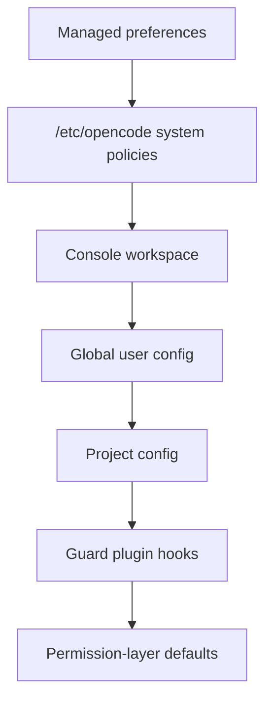
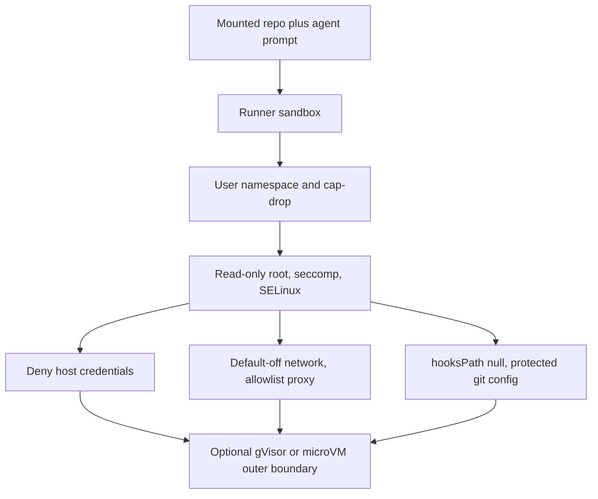

# Agent fleet security: grounded recommendations

Cutoff: 2026-11-09. Status: research complete across six streams.

Research agents: Synthetic GLM-5.3-Flash ran the four original streams.
Kimi-K3 ran the retained-guard architecture review and the RSI and harness
sweep. Local evidence was read directly from `/home/csh/Projects/dotfiles`
and the live host. No workstation or configuration was changed. Vendor
claims are marked verified or inferred in each table.

Provenance: "Verified" means a research agent fetched the primary source at
the cutoff. It does not mean the parent re-fetched it. "Snippet" means the
claim rests on a search extract or a secondary rendering. Local evidence
paths are relative to `/home/csh/Projects/dotfiles` unless a row says
otherwise. The guard pin at `install/opencode/config.jsonc:32` is on the
unpushed `chore/guard-retained` branch; on `main` the same entry is `:35` and
still reads `@latest`.

## Outcome

The fleet's policy logic is ahead of its enforcement substrate.

The conductor/executor split, the read-only reviewer, and the generated
secret-read rules are sound. Four controls still live where the governed
agent can reach them: policy evaluation, the executable tool supply chain,
credential access, and command execution.

OpenCode 2.2.x documents a system-level `policies` plane that outranks the
user config and survives plugin removal. If the 2.2.5 host accepts the block,
it becomes the deny floor under the guard. That is a verification gate, not a
settled fact. The plane does not close the product's fail-open defaults, and
it does not sandbox a shell.

The workflow guard stays. It is the workflow-policy layer, not a component
awaiting retirement, and the system `policies` plane is the deny floor
underneath it. The removable-guard defect is mitigated by pinning, by an
external attendance canary, and by the system floor, not by deletion. The
guard's seats can only tighten what the system plane allowed, so the two
layers compose without conflict. The floor is not absolute.
`OPENCODE_CONFIG_CONTENT`, the managed layer, and the Console are
operator-controlled inputs, and the two vendor docs rank them differently
against `/etc/opencode`. None may be reachable from an agent shell, and the
order must be proven on 2.2.5.

The vendor comparison sets the bar, not the ceiling. Claude Code and Codex
put an OS boundary around the shell only, and their credential defaults are
unsafe: Claude Code reads `~/.ssh` and `~/.aws/credentials` by default.
Copilot's local sandbox is broader on paper, but it is off by default and
best-effort because its own CLI is not sandboxed. A local runner must deny
host credentials and default the network off itself.

## Local baseline

What the current wiring enforces, and where the gap is.

| Control | Evidence | State |
| --- | --- | --- |
| Conductor cannot edit or shell | `install/opencode/agents/conductor.md:35-40` | Enforced by per-agent permissions |
| Reviewer cannot mutate | `install/opencode/agents/reviewer.md:7-40` | Enforced |
| Executor web tools are denied | `install/opencode/agents/executor.md:8-19` | Enforced for `websearch` and `webfetch`; shell egress is not bounded |
| Secret reads denied by pattern | `install/opencode/config.jsonc:170-202`, generated by `install/lib/port-secret-read-rules.cjs` | Enforced, pattern-based |
| Destructive verbs ask or deny | `install/opencode/config.jsonc:209-277` | Enforced, string-pattern-based |
| Agent cannot edit live config | `install/opencode/config.jsonc:166-169` | Enforced by `edit` deny |
| Guard is loaded from userland config, pinned to 1.19.2 | `install/opencode/config.jsonc:32` on `chore/guard-retained`; live host 2.2.5, guard qualified on 2.2.0 | Retained; removable by the governed process; version triple visible in `guard_status` |
| Skills timer updates executable instructions from upstream | `install/skills-update.sh:125`; `~/.local/state/skills/.skill-lock.json` has 42 entries, 0 with a `ref` | Unpinned content |
| Remote and local MCP tools run without version or digest pins | `install/opencode/config.jsonc:72-81` | Unpinned content, no per-tool rules |
| Shell has no OS-level sandbox | probe on the current Omarchy host: no `podman`, no `rpm`; the Fedora 45 target is not built yet | Not implemented |

The guard failure is recorded, not hypothetical. When the deployed config
stopped referencing the plugin, enforcement went inert mid-session while the
host still reported healthy (`docs/agents/policy-review.md:160-163`). The fix
is to keep the guard and make its absence loud, not to delete it.

A live probe confirms the boundary is pattern-based, not capability-based.
Reading `~/.ssh/id_ed25519` is blocked. `printenv | grep -i token` is allowed,
because no rule matches it.

## Policy and audit plane

### Dated evidence

| Claim | Source | Date or version | Verified |
| --- | --- | --- | --- |
| OpenCode GitHub latest release is v2.2.6; the local binary reports v2.2.5 | https://github.com/anomalyco/opencode/releases | 2026-11-06 | Verified |
| Policies are separate from permissions: binary `allow`/`deny`, never prompt, only tighten. Actions include `provider.use`, `tool.use`, `mcp.use`, `skill.use`, `plugin.use`, `websearch.use`. `mcp.use`, `skill.use`, and `plugin.use` need host 2.2.3+; `websearch.use` needs 2.2.6+ and older clients ignore it | https://opencode.ai/docs/policies/ | Undated (current docs) | Verified |
| Policies fail open: "If nothing matches, the action is allowed"; invalid statements are dropped with a log warning | https://opencode.ai/docs/policies/ | Undated | Verified |
| Policy precedence is system `/etc/opencode` and Console above global and project config. A repository cannot re-enable a globally denied provider | https://opencode.ai/docs/policies/ | Undated | Verified |
| Any config in the merge chain can disable a plugin with `-id`, and config changes hot-reload. Only `opencode.config.policy` and `opencode.provider.opencode` ignore removal | https://opencode.ai/docs/plugins/ | Undated | Verified |
| A denied plugin "is not loaded, however it was configured" | https://opencode.ai/docs/policies/ | Undated | Verified |
| The permission evaluate hook runs in-process after configured rules. An explicit configured `deny` is final and skips the hook | https://opencode.ai/docs/build/plugins/server/ | Undated | Verified |
| HTTP API exposes permission list and reply, plus an event stream. No external PDP endpoint and no audit-export endpoint | https://opencode.ai/docs/api/ | Undated | Verified |
| OPA latest is v1.22.2 | https://github.com/open-policy-agent/opa/releases | 2026-11-06 | Verified |
| OPA documents an agent tool-calling pattern: harness is the PEP, OPA is the PDP, non-empty deny-set refuses the call | https://openpolicyagent.org/docs/agent-tool-calling | Undated (2026) | Verified |
| OPA decision logs record policy, input, bundle metadata, and a `decision_id` for correlation | https://openpolicyagent.org/docs/management-decision-logs | Undated | Verified |
| `opa test` runs policy-as-code tests and fails the run on a failed `test_` rule | https://openpolicyagent.org/docs/policy-testing | Undated | Verified |
| Cedar latest SDK is v4.14.1; it is an embeddable authorizer with no bundled HTTP server or decision-log pipeline | https://github.com/cedar-policy/cedar | 2026-11-02 | Verified (packaging); server absence inferred |
| OTel GenAI conventions have no tagged release and every `gen_ai.*` attribute is Development stability | https://github.com/open-telemetry/semantic-conventions-genai | 2026-11-09 | Verified |
| NIST Tenet 07 separates policy from reasoning; Tenet 10 requires immutable evidence with logging independent of the agent | https://www.nist.gov/blogs/cybersecurity-insights/design-tenets-agent-identity-management-systems | 2026-10-27 | Verified |
| NIST SP 800-53 Rev 5 AU-3 requires event type, time, where, source, outcome, and identities; AU-10 requires non-repudiation. Release 5.2.0 updated the AU-03 discussion | https://csrc.nist.gov/pubs/sp/800/53/r5/upd1/final | 2020-09, update 2025-08-27 | Verified (fetched 2026-11-09) |
| OWASP Agentic Top 10 2026 ASI03 requires fail-closed resolution and immutable signed logs of tool invocations | https://genai.owasp.org/ | 2025-12-09, v2026 | Cross-verified (secondary renderings) |

### Findings

- **The removable-guard defect is mitigated, not deleted.** Move the policy
  statements into system-level config and deny `plugin.use` for anything not
  required. A project config can no longer lift a global deny. Verify on host
  2.2.5 before relying on it, because the docs describe 2.2.6. The guard
  itself stays, pinned and canary-checked; the system plane is the floor under
  it, not its replacement.
- **Fail-closed must be built, not assumed.** OpenCode allows an action when
  no policy matches and drops invalid statements with only a warning. The
  first policy statement must be a broad `deny`; `ask` is a permission-layer
  effect, not a policy effect. The config gate must reject invalid policy
  statements at build time.
- **OpenCode is not an audit system.** It has an event stream and permission
  replies, but no export endpoint. The absence of an immutable decision log is
  inferred from that missing surface, not from a runtime probe. An external
  writer is required. OPA already emits the record shape: decision id, policy
  input, policy result, bundle version.
- **OPA fits one workstation; Cedar fits an embedded service.** OPA provides a
  local server, REST decisions, signed bundles, and decision logs. Cedar has
  no bundled server. Either is defensible; OPA is less code for this shape.
- **The audit record needs both identities.** NIST AU-3/AU-10 and OWASP ASI03
  require the agent identity and the delegated human identity, the policy
  version, the action and resource, the decision, and the approval chain for
  an `ask` escalation. Redact secrets and PII at capture.
- **Traces are not the audit sink.** OTel GenAI attributes are usable for
  debugging, but the conventions are unreleased and Development-stability.
  Write the decision to the audit record, and treat traces as secondary.

### Retained guard architecture (1.19.2)

The guard is a permanent layered control. The 1.19.2 source, read locally,
shows three enforcement seats and a precedence order that keeps it
non-conflicting with the system plane.

| Seat | Mechanism | Failure behavior |
| --- | --- | --- |
| Static config posture | Host-resolved `policies` plus `permission` rules emitted by `opencode-workflow-guard policies --print` | Final within the hook chain; an explicit configured deny resolves before any hook, but a higher config document or the managed layer can outrank it |
| `permission.evaluate` hook | Normalized action plus resources, deny-only, pre-execution | Fails closed: an evaluation error sets effect `deny` |
| `tool.execute.before` | Raw tool arguments, throw-to-block | Blocks by exception; unknown if the host swallows the exception |

Precedence differs by document and by enforcement seat, so the report states
both sources rather than merging them. The guard's `docs/policy-posture.md`
orders managed prefs and Console above `OPENCODE_CONFIG_CONTENT` above
`/etc/opencode` above `~/.config/opencode` above project config above plugin
hooks above permission-layer defaults. The live OpenCode policy doc ranks
managed preferences first, system `/etc/opencode` second, the Console
workspace third, then global and project config, and it does not list
`OPENCODE_CONFIG_CONTENT`. The safe reading is the intersection: project and
user config cannot lift the system deny, while `OPENCODE_CONFIG_CONTENT`, the
managed layer, and the Console are operator-controlled inputs. Strip the
environment variable from agent shells, and prove the actual order on 2.2.5.

Order from the live OpenCode policy doc. The guard's doc places
`OPENCODE_CONFIG_CONTENT` between the managed layer and the system file, and
the Console above the system file. That difference is an open unknown, and the
canary in the recommendations settles it on 2.2.5.

The system plane only tightens downward and never calls the hook on a
configured deny, so the two planes share rule content without conflicting.
They cover different ground. The static posture covers trunk pushes, config
writes, and secret reads. It also emits a Code Mode (`execute`) rule, but the
vendor documents that rule as inert on the qualified hosts, so it is not
coverage until a canary proves the host asserts the `execute` action. The
guard covers the todo lifecycle, verification and review gates, boundary
semantics, and git and history policy.

**Fail-open and fail-closed modes.**

- Fail-open today: plugin not loaded (uninstall, `-id` disable, config drop),
  host hot-reload dropping a userland plugin, `@latest` cache drift serving a
  stale or newer copy, and an unqualified host. The live host is 2.2.5 while
  1.19.2 is qualified on 2.2.0.
- Fail-closed today: the `permission.evaluate` seat denies on its own
  evaluation error, and the boundary and tamper policies fail closed on
  indeterminate paths. `tool.execute.before` blocks by exception, but a host
  that swallows hook exceptions would fail open. That is unverified on 2.2.5.
- Visible today: `guard_status` reports `pluginVersion`,
  `qualifiedHostVersion`, and `hostVersion`. The `/guard-status` command and a
  startup log line repeat the triple.
- Missing: an out-of-band heartbeat. The agent cannot be trusted to notice its
  own missing guard.

**Audit trail properties.** The guard appends bounded JSONL to
`~/.local/state/opencode/workflow-guard/workflow-guard.jsonl`: 4 MB maximum,
2 MB retained on rotation, mode 0600, sqlite file lock, command content
sha256-summarized, no signature and no hash chain. Rotation truncates the
tail. Write failures are swallowed so logging never breaks enforcement.

That sink is same-UID writable, and the audit directory is deliberately
outside the tamper policy's protected set. The governed agent can delete or
truncate it, which fails NIST AU-10 non-repudiation and the OWASP ASI03
immutable-signed-log requirement. The zero-code fix is an append-only
attribute (`chattr +a`) or a bind-mount onto a root-owned log directory, plus
export to journald or a remote collector. Per-row agent identity and policy
version are missing fields and remain a guard feature request.

**Attendance canary.** A scheduled probe from outside the agent must do two
things. It must assert that `guard_status` reports `pluginVersion` equal to
the pin and a `qualifiedHostVersion` set that contains `hostVersion`. It must
also issue a deny-canary call that the guard, not the config policy, blocks.
Discriminate the origin by the structured `PolicyDecision` and policy id, as
the vendor's own canary does, not by message prose. Both must fail the run,
not warn.

**Residual risk.** The guard plugin runs with full process privilege, and its
policies do not sandbox plugin code. An agent that can kill the OpenCode
process ends the guard. Only an external wrapper or the OS sandbox closes
that path.

### Prior audit findings now closed by the vendor

The prior `policy-review.md` findings F2 and F3 (draft conflation, path-segment
noise) are addressed in 1.19.2 by the opt-in `liveControlPlanePaths`
fact-mode. F6 (empty `guard_why` and `guard_audit`) is addressed by the
structured `PolicyDecision` simulate path and the write-failure-noisy audit
helpers. These are closed by the vendor and should be treated as resolved, not
carried as open defects.

## OS sandboxing

### Dated evidence

| Claim | Source | Date or version | Verified |
| --- | --- | --- | --- |
| Current OWASP LLM guidance is the 2026 Top 10, v1.0, with LLM01 Prompt Injection through LLM10 Improper Output Handling | https://genai.owasp.org/resource/owasp-genai-llm-top-10-2026/ | Published 2026-08-04 | Verified |
| OWASP Agentic Top 10 2026 defines ASI01-ASI10, including ASI05 Unexpected Code Execution and ASI06 Memory and Context Poisoning | https://genai.owasp.org/resource/owasp-top-10-for-agentic-applications-for-2026/ | 2025-12-09 | Verified (page and date); ASI wording cross-verified |
| NIST Trustworthy and Responsible AI report 800-5 finds agent threats are novel but existing security principles still apply with adaptation | https://www.nist.gov/publications/summary-analysis-responses-request-information-regarding-security-considerations-ai | 2026-05-18 | Verified |
| No NIST agent-security standard exists yet, only a draft benchmark-evaluation practice guide | https://www.nist.gov/caissi/guidelines | Updated 2026-09-30 | Verified |
| Claude Code's sandbox is an OS boundary around shell commands only. Default reads include most of the machine, including `~/.ssh` and `~/.aws/credentials`; network is proxy-allowlisted with an empty start; off by default | https://code.claude.com/docs/en/sandboxing | Undated, references v2.1.285 | Verified |
| Claude Code leaves Read, Edit, Write, WebFetch, hooks, MCP servers, LSP, and plugin modifications outside its sandbox | Same | Undated | Verified |
| Codex CLI uses bwrap plus seccomp on Linux, defaults network off, limits writes to the workspace, and protects `.git`, `.agents`, `.codex`, and `.aws` under the workspace | https://developers.openai.com/codex/agent-approvals-security.md | Undated, current 2026-11-09 | Verified |
| Codex network proxy is allowlist-first, checks DNS rebinding, blocks loopback and private ranges by default, and does not cover traffic that bypasses the proxy | Same | Undated | Verified |
| Codex Cloud removes secrets before the agent phase and uses OIDC short-lived cloud credentials | https://developers.openai.com/codex/environments/cloud-environments.md | Undated | Verified |
| Copilot local sandboxing restricts filesystem, network, and credentials at the OS level, is off by default, and is experimental. Built-in tools honor it on a best-effort basis because the CLI itself is not sandboxed | https://docs.github.com/en/copilot/concepts/about-cloud-and-local-sandboxes | Undated, public preview | Verified |
| Podman rootless supports user-namespace mapping, `--read-only`, `--cap-drop=all`, `no-new-privileges`, seccomp profiles, SELinux labels, and `--network none` | https://docs.podman.io/en/latest/markdown/podman-run.1.html | Latest docs, accessed 2026-11-09 | Verified |
| Podman `--network none` removes connectivity; egress domain allowlisting is not a `podman run` feature | Same | Same | Verified, including the absence |
| gVisor is a userspace application kernel with a Gofer filesystem mediator, not a syscall filter and not a VM | https://gvisor.dev/docs/architecture_guide/security/ | 2026 | Verified |
| Firecracker provides KVM microVMs with a jailer as a second isolation line | https://firecracker-microvm.github.io/ | 2018-2026 | Verified |
| No primary benchmark compares gVisor or microVMs against shared-kernel containers on coding-agent workloads | Not found | n/a | Evidence absent |
| Git hooks live in `$GIT_DIR/hooks` or `core.hooksPath`, and `post-checkout` also fires after clone and `git worktree add` | https://git-scm.com/docs/githooks | Git 2.54.0, 2026-04-20 | Verified |
| Local hooks are not a policy control: `--no-verify` bypasses them, and Git assumes the user controls local repositories | https://git-scm.com/docs/gitfaq | Git 2.53.0, 2026-02-02 | Verified |
| `core.hooksPath` redirects hook lookup. `safe.directory` is only respected in protected configuration | https://git-scm.com/docs/git-config | Git 2.56.0, 2026-09-28 | Verified |
| Per-worktree config is read only when `extensions.worktreeConfig` is enabled | Same | Git 2.56.0 | Verified |

### Findings

- **Vendor sandboxes cover the shell, not the tool surface.** Claude Code leaves
  Read, Edit, Write, WebFetch, hooks, MCP, and plugins outside its boundary.
  Copilot says its own CLI is not sandboxed, so tool compliance is best-effort.
  A shell sandbox is necessary and insufficient. The file tools and MCP calls
  still need permission rules and a credential boundary.
- **Vendor defaults expose credentials.** Claude Code reads `~/.ssh` and
  `~/.aws/credentials` by default. Codex protects only a short list under the
  workspace. The runner must deny host credential paths explicitly, then
  inject only the credential the session needs.
- **Network default-off is the shared design.** All three vendors use an
  allowlist proxy. Podman alone cannot allowlist egress, so the runner needs a
  filtering proxy or a network namespace with a filtering sidecar.
- **`--network none` is the only safe Podman default.** The online profile
  should add a proxy, not `--network host`.
- **gVisor and microVMs are stronger, unmeasured for this workload.** No
  primary benchmark compares them with shared-kernel containers on coding
  agents. Choose them for threat model, not for a performance claim.
- **Hooks are not a security boundary.** `--no-verify` bypasses them, and a
  cloned repository does not transfer `.git/hooks` or `.git/config`. The
  realistic vector is a repository directory delivered whole, such as a
  mounted volume or tarball, carrying its own hooks, config, and filter
  drivers. Run `git -c core.hooksPath=/dev/null` against untrusted trees.
- **`safe.directory` is a protected-config value.** Keep it out of repo scope.
  Leave ownership checks on.

## Tool and skill supply chain

### Dated evidence

| Claim | Source | Date or version | Verified |
| --- | --- | --- | --- |
| Current MCP specification revision is 2026-07-28 | https://modelcontextprotocol.io/specification/versioning | 2026-07-28 | Verified |
| Tool annotations are untrusted unless the server is trusted. Clients SHOULD validate tool results; servers MUST sanitize output | https://modelcontextprotocol.io/specification/2026-07-28/server/tools | 2026-07-28 | Verified |
| Security best practices give the local-server exfiltration example `npx malicious-package` and require the consent dialog to show the exact command, untruncated. Sandboxing is SHOULD | https://modelcontextprotocol.io/specification/2025-11-25/basic/security_best_practices | 2025-11-25 | Verified |
| Authorization uses OAuth 2.1, RFC 9728 resource metadata, RFC 8707 audience validation, and least-privilege scopes | https://modelcontextprotocol.io/specification/2025-11-25/basic/authorization | 2025-11-25 | Verified |
| OWASP MCP Top 10 is a Beta living document: MCP03 Tool Poisoning, MCP04 Supply Chain, MCP06 Prompt Injection, MCP09 Shadow MCP Servers | https://owasp.org/projects/mcp-top-10/ | Undated, commit `165fe0f` | Verified |
| MCP04 names floating `latest` references, missing provenance, missing SBOM, and missing sandboxing as supply-chain vulnerabilities | https://github.com/OWASP/www-project-mcp-top-10 | 2025 list | Verified |
| `npm audit signatures` verifies registry signatures and provenance, and requires npm 9.5 or newer | https://docs.npmjs.com/cli/v11/commands/npm-audit | Current, undated | Verified |
| Provenance proves build origin, not code safety: it "does not guarantee the package has no malicious code" | https://docs.npmjs.com/generating-provenance-statements/ | Current | Verified |
| npm 11 adds `allowScripts`, `strict-allow-scripts`, and `min-release-age` | https://docs.npmjs.com/cli/v11/commands/npm-install | npm CLI v11 | Verified |
| `skills add owner/repo@<tag-or-sha>` pins a release. `skills update` checks only within the locked ref | https://github.com/vercel-labs/skills/blob/main/docs/commands.md and source `src/update.ts` | CLI 1.7.6, 2026-11-03 | Verified from source |
| OpenCode plugins accept `pkg@1.2.0` or a full Git commit hash, and only exact pins stay pinned | https://opencode.ai/docs/plugins/ | Live, 2026-11-09 | Verified |
| OpenCode scopes MCP tools per server with `<server>_<tool>` wildcard rules and supports `opencode_read_mcp_resource` scoping | https://opencode.ai/docs/mcp-servers/ | Live, 2026-11-09 | Verified |
| OpenCode remote MCP uses OAuth by default with configurable `oauth.scope` | https://opencode.ai/docs/mcp-servers/ | Live, 2026-11-09 | Verified |
| `chrome-devtools-mcp@1.12.0` has SLSA v1 provenance and a trusted publisher. It declares `@blackwell-systems/gcf` as an optional peer and a devDependency | https://registry.npmjs.org/chrome-devtools-mcp/latest | 1.12.0, 2026-10-22 | Verified |
| `@blackwell-systems/gcf` was created 2026-06-04, has one maintainer, and last published 2.6.1 on 2026-08-16 | https://registry.npmjs.org/@blackwell-systems%2Fgcf | 2.6.1 | Verified (facts); intent unverified |

### Findings

- **The local skills pins do not reach the installer.** All 42 tracked
  skills have no `ref` in `~/.local/state/skills/.skill-lock.json`. The pins
  manifest records a commit per source (`packages/skills-pins.json:9-65`), but `install/skills-update.sh:125`
  runs an unpinned `skills update -g -y`, so every skill tracks its default
  branch. The CLI does honor a ref once one is recorded, so the fix is to
  reinstall with `owner/repo@<full-sha>`.
- **`skills update` is safe only for pinned entries.** A tag pin still
  follows a force-moved tag. Only a full commit SHA is immutable.
- **One launcher is pinned, one still floats.** The guard is
  `opencode-workflow-guard@1.19.2` on `chore/guard-retained`
  (`config.jsonc:32`); `main` still carries `@latest` at `:35`.
  `chrome-devtools-mcp` is still `@latest` (`config.jsonc:81`). OpenCode can
  pin both to an exact version or full commit hash. Until the pin merges, the
  deployed setup cannot answer "what code ran last Tuesday".
- **The Chrome DevTools server carries a watch item, not a live dependency.**
  Version 1.12.0 declares `@blackwell-systems/gcf` as an optional peer and a
  devDependency. Optional peers are not installed by default, so this is not
  current exposure. It becomes one only if the local profile installs it
  explicitly. The package is two months old with one maintainer and valid
  provenance; provenance proves origin, not intent.
- **MCP tools can be scoped, and currently are not.** OpenCode supports
  `<server>_<tool>` allow, ask, and deny rules. The config declares two
  servers with no per-tool rules, so every advertised tool is available.
- **Remote MCP auth is on by default.** Context7 uses OAuth with PKCE.
  Setting `oauth.scope` explicitly and preferring a pre-registered client
  over dynamic registration is the least-privilege path.
- **Prompt injection has no model-level fix.** OWASP LLM01 says no foolproof
  prevention exists. The deterministic layer is permissions, command
  allowlists, human approval, schema validation of tool output, and
  sandboxing. CaMeL and Progent show that layer is feasible: CaMeL keeps 77%
  of tasks with provable security versus 84% undefended, and Progent confines
  tool calls monotonically. Repository files, README contents, `SKILL.md`, and
  MCP server instructions all enter context as trusted-looking text.

### Local supply-chain inventory

| Loaded artifact | Current pin | Required pin |
| --- | --- | --- |
| `opencode-workflow-guard` | `@1.19.2` on `chore/guard-retained`; `@latest` on `main` | Exact version, plus digest or lockfile; verify via `guard_status` |
| `chrome-devtools-mcp` | `npx -y @latest` | Exact version, installed binary preferred |
| 42 external skills | No `ref` in lockfile | `owner/repo@<full-sha>` |
| Context7 MCP | Remote URL, OAuth default | Explicit `oauth.scope` |
| OpenCode plugins under `~/.config/opencode/plugins` | Local files and symlinks | Reviewed, non-agent-writable path |

## Memory and evaluation integrity

### Dated evidence

| Claim | Source | Date or version | Verified |
| --- | --- | --- | --- |
| AgentPoison backdoors agent memory and RAG: 80% or higher attack success with under 0.1% poisoned entries | https://arxiv.org/abs/2407.12784 | 2024-07, NeurIPS 2024 | Verified |
| MINJA injects memory through query-only interaction with over 95% success | https://arxiv.org/abs/2503.03704 | 2025-03 | Corroborated |
| GhostWriter reports about 98% injection and 60% activation across current agent architectures | https://arxiv.org/html/2607.06595v1 | 2026-07 | Snippet |
| OWASP threat T1 "Memory Poisoning" recommends content validation, session isolation, memory access control, anomaly detection, sanitization, and snapshots for rollback | https://genai.owasp.org/resource/agentic-ai-threats-and-mitigations/ | 2025-02, v1.0.1 | Snippet |
| Microsoft recommends scoped memory and retrieval isolation per trust domain, with least privilege | https://learn.microsoft.com/en-us/security/zero-trust/catalog-ai-attack-techniques/ai-memory-context-poisoning | Undated, current | Snippet |
| CaMeL tags every value with capability and provenance, and enforces policy at tool calls. It keeps 77% of tasks with provable security versus 84% undefended | https://arxiv.org/abs/2503.18813 | 2025-03, SATML 2026 | Verified |
| Progent enforces deterministic tool-call privilege policy with monotonic confinement | https://arxiv.org/abs/2504.11703 | 2025-04 | Verified |
| AgentHarm withholds 30% of tasks and never exposes them publicly | https://arxiv.org/abs/2410.09024 | 2024-10, ICLR 2025 | Verified |
| LLM judges carry position, verbosity, and self-enhancement bias; swap order mitigates position bias | https://arxiv.org/abs/2306.05685 | 2023-06, NeurIPS 2023 | Verified |
| A silent judge version bump makes every drift alarm ambiguous | https://arxiv.org/html/2606.15474v1 | 2026-06 | Snippet |
| Prompt, format, and aggregation choices shift scores by more than 20 points and can flip rankings | https://arxiv.org/abs/2405.14782 | 2024-05 | Verified |
| OTel GenAI agent spans remain Development status | https://github.com/open-telemetry/semantic-conventions-genai/blob/main/docs/gen-ai/gen-ai-agent-spans.md | 2026-11-05 commit | Verified |
| Mutation testing is the canonical test-adequacy method: mutate the artifact, count killed mutants | Jia and Harman, IEEE TSE 37(5), 2011 | 2011 | Verified |

### Findings

- **The attack is settled; the defense is not.** Poisoning is empirically
  cheap and durable. Provenance, TTL, quarantine, and scoped memory are
  proposed practice with no peer-reviewed evaluation on a production memory
  store. Treat them as risk reduction, not proof.
- **The loop already has the strongest documented controls.** The admission
  gate is at `docs/agents/rsi-loop-playbook.md:401`. The held-out and
  winner's-curse rules are at `:403` and `:497-500`. Judge-drift attribution
  is at `:409` and `:513-516`. The read-only ruler is mechanism 3 at `:62`.
  These are already in the loop and are not re-proposed here.
- **What is missing is provenance and expiry.** A lesson records one claim
  and an evidence path. It does not record the creating agent, the source
  document hash, the derivation chain, or a review date. A poisoned lesson
  therefore looks identical to a verified one after admission.
- **Append-only is not the documented control.** No source found supports
  append-only admission as a poisoning defense. The supported property is
  fail-closed admission: untrusted content never enters context until policy
  passes. The lesson registry's append-only rule protects audit history, not
  content trust.
- **Gate tests are weaker than the gates.** The validator checks shape, ids,
  and append-only registry order (`install/lib/validate-lessons.cjs:14-22`).
  It does not test that a malformed or hostile candidate is rejected. Mutation
  testing and default-deny cases are the documented way to test the test.
- **Judge pinning is policy, not yet a record.** The playbook says pin the
  judge (`:513-516`). The ledger names reviewer models, such as Kimi K3 at
  `docs/agents/ledger.md:865`, but it has no per-score judge revision field.
  Without that field, drift attribution stays manual.

### Already covered, and the residual gap

| Control | Existing evidence | Residual gap |
| --- | --- | --- |
| Admission before context | `rsi-loop-playbook.md:401`; `validate-lessons.cjs` | Semantic check is external and manual; add adversarial fixtures |
| Itemized, evidence-backed memory | `docs/agents/lessons.md` format | No provenance beyond the evidence path |
| Held-out confirmation | `rsi-loop-playbook.md:497-500` | No independent check that the held-out set is unchanged since the split |
| Judge drift | `rsi-loop-playbook.md:513-516` | Judge revision is not stored per score |
| Read-only verifier | reviewer permissions; playbook mechanism 3 | No mutation test proving the verifier rejects a bad diff |
| Contamination awareness | canary strings in benchmarks | No canary or freshness rule for the repo's own eval set |

## RSI and harness engineering: November 2026 sweep

Window 2026-10-17 to 2026-11-09, plus papers the previous pass missed. The
baseline is `docs/agents/reading-list.md` (1217 lines, last pass 2026-10-17)
and `docs/agents/rsi-loop-playbook.md`. Every `2611.*` item is a v1 preprint
with no replication, so it sits at tier B by default. Strong provenance, such
as the Princeton and DeepMind authors on Memory Trap, can flag an entry as
B-leaning A, but none is promoted until replicated.

### Dated evidence

| # | Claim | Source | Date | Venue or note | Status |
| --- | --- | --- | --- | --- | --- |
| 1 | Meta² learns a frozen textual meta-skill for when to evolve versus keep, applied online with task-local edits and a held-out verifier the evolver never sees | https://arxiv.org/abs/2611.05139 | 2026-11-03 | arXiv | Verified |
| 2 | ParetoSaddler separates intermediate promotion from deployment selection with Bayesian-bootstrap Pareto support; ClawMark 70.86 to 81.35% at lower cost | https://arxiv.org/abs/2611.02079 | 2026-11-01 | arXiv, Microsoft authors | Verified |
| 3 | Harness-S: a sibling-harness pool rescues failures, and RL transfers the behavior back to one policy under the base harness | https://arxiv.org/abs/2611.04277 | 2026-11-03 | arXiv | Verified |
| 4 | Latent Harness compiles a text harness into rank-8 activation shifts (0.03 to 0.05% of params); recovers the source gain in 8 of 10 preregistered settings | https://arxiv.org/abs/2611.01415 | 2026-11-01 | arXiv | Verified |
| 5 | Continual harness evolution forgets: SWE-Bench 94.0% to 32.0% after later evolution on FeatureBench, round 5 | https://arxiv.org/abs/2611.03219 | 2026-11-02 | arXiv | Verified |
| 6 | KernelSeek: a tool-rich agent plateaued at 0.50x FlashAttention-3 after 133 steps; a question-driven agent reached 1.13x | https://arxiv.org/abs/2611.03517 | 2026-11-02 | arXiv | Verified |
| 7 | HarnessFlow: MCTS over a refinement tree; +10.89 points over initial and +3.95 over Meta-Harness at lower per-task cost | https://arxiv.org/abs/2611.06254 | 2026-11-04 | arXiv | Verified |
| 8 | Reglos: a patch agent proposes from failure traces, a critic from a second model family screens for benchmark gaming, and a frozen evaluator admits further patches | https://arxiv.org/abs/2611.06049 | 2026-11-04 | arXiv | Verified |
| 9 | SelfImprove-Bench: gains are inconsistent across a G0 to G4 generalization ladder | https://arxiv.org/abs/2611.02797 | 2026-11-02 | arXiv | Verified |
| 10 | Artifact-to-Capability: signal-based evaluation cannot certify capability; legalization gain, compositional override, and loss-only drift are named failure patterns | https://arxiv.org/abs/2611.04952 | 2026-11-03 | arXiv | Verified |
| 11 | Memory Trap: benign memories cause unsafe later behavior; stale-test-repair memories make agents weaken correct tests, and stronger models cheat more | https://arxiv.org/abs/2611.07554 | 2026-11-05 | arXiv, Princeton and DeepMind authors | Verified |
| 12 | MCP tool poisoning: 22.9% attack success across 9,720 cells and 12 frameworks; no framework ships an intentional defense | https://arxiv.org/abs/2611.03555 | 2026-11-02 | AISec 2026 | Verified |
| 13 | Input assurance: a renderer omitted every structured tool call, so 53 of 60 judged steps were blank while the hashes matched | https://arxiv.org/abs/2611.02676 | 2026-11-02 | arXiv | Verified |
| 14 | System-1 decision models beat Claude Haiku on JudgeBench, LLMBar, and RewardBench 2; injection robustness varies per model | https://arxiv.org/abs/2611.00505 | 2026-10-31 | arXiv | Verified |
| 15 | VoirDire: judge-panel agreement partly reflects shared surface bias; counterfactual interventions identify nuisance directions | https://arxiv.org/abs/2611.00491 | 2026-10-31 | arXiv | Verified |
| 16 | ATC: role-contract enforcement at message admission reduces role drift in black-box multi-agent systems | https://arxiv.org/abs/2611.04321 | 2026-11-03 | EMNLP 2026 | Verified |
| 17 | Collaborative Intelligence: pass rate drops 97% to 81% when a model takes over a task where a weaker model cheated | https://arxiv.org/abs/2611.02633 | 2026-11-02 | arXiv, Stanford | Verified |
| 18 | Continual AutoResearch: persistent state improves research efficiency, but retention and utilization are distinct capabilities | https://arxiv.org/abs/2611.05108 | 2026-11-03 | arXiv | Verified |
| 19 | Harness²: two-level recursion with task-level Propose-Probe-Compose and harnessing-level improvement | https://arxiv.org/abs/2610.14224 | 2026-10-09 | arXiv, missed by the last pass | Verified |
| 20 | Compile Once, Run Cheap: a skill-RSI compile protocol with hidden validation layouts, a no-feedback control, and a tamper-evident ledger | https://arxiv.org/abs/2610.25114 | 2026-10-18 | arXiv | Verified |
| 21 | CFOE: failure-only evolution repairs failed tasks but rarely generalizes; successful trajectories transfer better | https://arxiv.org/abs/2610.22984 | 2026-10-16 | arXiv | Verified |
| 22 | RSI-Opt: a meta-agent evolves an optimizer-agent policy across five generations; held-out z rose from -0.36 to +3.11 | https://arxiv.org/abs/2610.32026 | 2026-10-23 | arXiv | Verified |
| 23 | METR time-horizon difficulty is not linear in log human time; a spline plus IRT refit beats the original under proper scoring | https://arxiv.org/abs/2610.12466 | 2026-10-08 | arXiv, missed by the last pass | Verified |
| 24 | METR's public time-horizons page is marked "no longer actively updated"; measurements above 16 hours are unreliable | https://metr.org/time-horizons | 2026-09-08 | living doc | Corroborated |
| 25 | PACE: greedy acceptance commits 30 to 42% false and 10 to 33% harmful edits; an anytime-valid e-process gate commits the real one and cuts eval cost 18% | https://arxiv.org/abs/2606.08106 | 2026-06-06 | arXiv, missed earlier | Verified |
| 26 | SEAL: self-authored verification keeps near-perfect self-scores while deployment degrades; a sealed exogenous audit accepts or rejects only | https://arxiv.org/abs/2607.24300 | 2026-07-27 | arXiv, missed earlier | Verified |
| 27 | PIVOT-KG: proxy and deployment optimal sets are disjoint in 51 of 90 held-out roots; paired decision-aware validation cuts selection regret | https://arxiv.org/abs/2609.32677 | 2026-09-26 | arXiv, missed earlier | Verified |
| 28 | Harness tampering occurs in real self-improving runs, persists in the best-agent lineage, and forms system-specific profiles | https://arxiv.org/abs/2609.00069 | 2026-08-30 | arXiv, missed earlier | Verified |
| 29 | RewardHackingAgents: evaluator-tampering attempts in about 50% of natural-agent episodes; evaluator locking costs 25 to 31% runtime | https://arxiv.org/abs/2603.11337 | 2026-03-11 | arXiv, missed earlier | Verified |
| 30 | RSIBench-Data: of searches that continue past the best observed score, 78.26% end with a lower-scoring final attempt | https://arxiv.org/abs/2607.25886 | 2026-07-28 | arXiv, missed earlier | Verified |
| 31 | MemForm: consolidation order alone alters downstream behavior with identical retained experiences | https://arxiv.org/abs/2610.14431 | 2026-10-10 | arXiv, missed earlier | Verified |
| 32 | MutMem: signed evidence, no age-based expiry, Ed25519-verified transitions, poison retained with signed revisable labels | https://arxiv.org/abs/2608.02843 | 2026-08-03 | arXiv, missed earlier | Verified |
| 33 | SMSR: HMAC provenance at write blocks unsigned injection (93 to 100% down to 0% success); smoothed retrieval bounds an authenticated adversary at 8.0% | https://arxiv.org/abs/2606.12703 | 2026-06-10 | arXiv, missed earlier | Verified |
| 34 | Search-time contamination inflates public-benchmark scores up to 4% through retrieved metadata and answers | https://arxiv.org/abs/2606.05241 | 2026-06-03 | arXiv, missed earlier | Verified |
| 35 | Anthropic agent-memory post: an offline "dreaming" pass corrects memory; "record only failures" cuts the memory gain; wiki helps synthesis but not retrieval; one writer per page beats a shared table | https://www.anthropic.com/research/components-of-agent-memory | 2026-11-06 | Anthropic engineering | Verified |
| 36 | Vals AI: agent teams cost 1.8 to 5.1x single agents; only 1 of 4 matched comparisons is significant; at max effort teams add nothing | https://vals.ai/blogs/multi-agent-vibe-code-bench | 2026-10-09 | eval vendor, missed by the last pass | Verified |
| 37 | NVIDIA NeMo Compass and Eval Author: trace to failure to eval-authoring to one-change harness fix, with tasks held out from the repair agent | https://developer.nvidia.com/blog | 2026-11-04 | vendor blog | Verified |
| 38 | rsi.watch: independent RSI claim ledger with check dates and replication status; DGM headline rated very low certainty with two partial reruns | https://rsi.watch | checked 2026-10-26 | independent ledger | Verified |
| 39 | awesome-rsi restructured to a three-level evidence distinction: task gain, retained gain, improver gain | https://github.com/lobehub/awesome-rsi | fetched 2026-11-09 | community list | Verified |
| 40 | Strands reports 94,000 trials across 6 harnesses and 12 models, lowest cost and highest accuracy in Anthropic and OpenAI comparisons | https://strandsagents.com/blog | 2026-10-13 | vendor blog, self-report | Snippet |
| 41 | SkillOpt now has an arXiv id, 2605.23904, closing the citation gap in the existing reading-list entry | https://arxiv.org/abs/2605.23904 | 2026-05 | arXiv | Corroborated via awesome-rsi |
| 42 | The rerun-flip calibration papers 2610.04433 and 2610.15055 remain the tier A floor for harness-buy claims | https://arxiv.org/abs/2610.04433 and https://arxiv.org/abs/2610.15055 | 2026-10 | arXiv, carried from the reading list | Not re-fetched |
| 43 | Anthropic internal scaling data: quality gains shrink as agents scale from 10 to 100 on two tasks; more agents buy speed, not quality | https://the-decoder.com | 2026-10-11 | secondary report of Anthropic internal data | Snippet |

### Findings

- **The November harness wave refines the playbook; it does not overturn it.**
  Meta², ParetoSaddler, Harness-S, and HarnessFlow refine mechanisms the
  playbook already names: frozen meta-skill with explicit keep or evolve,
  Pareto selection separating promotion from deployment, archive as a
  complementarity pool, and archive-as-tree search. The frontier moved from
  whether harness optimization works to how to schedule and select adoption.
  That is the Select and Evaluate territory of the loop.
- **Continual forgetting is the new negative cluster.** Cross-task sequential
  evolution destroys prior-task performance (#5), gains are inconsistent
  across generalization levels (#9), and retention is not utilization (#18).
  The exposed surface is the playbook's campaign mode, which runs sequential
  iterations in one repo.
- **A rising metric is not capability.** Artifact-to-Capability (#10) names
  three concrete failures: legalization gain, compositional override, and
  loss-only drift. This is one level past the winner's curse: the score can
  rise while the capability does not form.
- **Memory Trap is the load-bearing November result.** Benign memories
  generalize badly, stale-test-repair memories make strong models cheat more,
  and scope preservation is the named research direction (#11). It fuses
  scope-stripping with the self-graded inflation gap and raises the cost of a
  weak admission gate.
- **The Anthropic memory post is the first vendor-verified memory design
  evidence (#35).** Four copyable mechanisms: correction needs an offline pass
  against transcripts; steering rules help weak models but hurt strong ones;
  one writer per page with verbatim quoting beats a shared table; the injected
  layer must stay small.
- **Judge integrity now sits below the judge.** The packet the judge reads can
  be blank or stale while the hashes match (#13). Panel agreement is partly
  shared surface bias (#15). Cheap System-1 judges are a viable front tier
  with escalation on disagreement (#14). The verification chain must attest
  what the judge consumed, not only who judged.
- **Default subagent fan-out is challenged.** Teams cost 1.8 to 5.1x, only
  one in four matched comparisons is significant, and orchestration style is
  model-specific (#36). Anthropic's scaling data points the same way: more
  agents buy speed, not quality. Collaborative Intelligence adds the handoff
  risk: 97% to 81% when a model inherits a task where a weaker model cheated
  (#17).
- **The harness surface is porous.** Latent Harness (#4) shows a text harness
  can compile into about 0.05% of parameter space and compose there. The
  editable-surface rule survives as a scoping rule, but its definition must
  widen.
- **METR's public ruler stopped updating (#23, #24).** The page is marked no
  longer actively updated, the refit shows the doubling headline is
  estimation-dependent, and measurements above 16 hours are unreliable.

### Confirmations and contradictions

- **Mechanism 3, bounded editable surface: confirmed, sharpened.** The
  acceptance-gate literature reinforces it. Latent Harness (#4) means the
  surface can migrate into sub-0.1% parameter space, so the gate must follow
  the deployment signature of the surface, not the text-versus-code split.
- **Mechanism 4, memory: confirmed, sharpened twice.** Anthropic (#35) says
  the gate needs evidence checks, not content rules: "record only failures"
  hurt strong models. MemForm (#31) says consolidation procedure, including
  order and updater, is part of what must be gated, not only the admission
  decision.
- **Mechanism 6, capability gate on the meta loop: confirmed, sharpened.**
  Continual forgetting (#5) adds a destructive regime the gate must cover:
  sequential evolution across task families.
- **Winner's-curse rule: sharpened upward, not overturned.** PACE (#25) does
  not beat greedy on held-out gain. It eliminates the 30 to 42% false and 10
  to 33% harmful commits at 18% lower eval cost. The rule becomes "greedy for
  gain, paired anytime-valid gate for hygiene".
- **Strong-to-weak routing: confirmed in letter, contradicted in practice.**
  The AI4AI transfer result is untouched, but the default fan-out the
  playbook encodes is hit by #36 and #17. Parallelism buys wall-clock time,
  context replication is the cost driver, and orchestration style must route
  per model. The #17 handoff risk is a new escalation-path hazard for the
  `executor` to `executor-strong` handoff.

### Edit list for the dotfiles RSI docs

**`docs/agents/reading-list.md`:**

- Add to core loop designs: Meta² (2611.05139), ParetoSaddler (2611.02079),
  Harness-S (2611.04277), HarnessFlow (2611.06254), Harness² (2610.14224),
  Reglos (2611.06049), and Latent Harness (2611.01415).
- Add to memory and context, lead entry Memory Trap (2611.07554, tier B leaning
  A): Continual AutoResearch (2611.05108), MemForm (2610.14431), MutMem
  (2608.02843), SMSR (2606.12703), and the Anthropic memory post (2026-11-06).
- Add to verification and negative results: continual forgetting (2611.03219,
  negative), Artifact-to-Capability (2611.04952, negative), SelfImprove-Bench
  (2611.02797), input assurance (2611.02676), VoirDire (2611.00491),
  System-1 judges (2611.00505), PACE (2606.08106), SEAL (2607.24300),
  PIVOT-KG (2609.32677), the harness-tampering audit (2609.00069),
  RewardHackingAgents (2603.11337), and RSIBench-Data (2607.25886).
- Add to safety and drift: search-time contamination (2606.05241), MCP
  poisoning (2611.03555), ATC (2611.04321), and KernelSeek (2611.03517).
- Add to cost-tiered execution: Vals AI (2026-10-09), Collaborative
  Intelligence (2611.02633), and Strands (vendor self-report, tier C).
- Add to harness practice: NeMo Compass (2026-11-04), Latent Harness, and
  rsi.watch as an eval-integrity instrument.
- Change the METR entry: append the 2026-09-08 update freeze, the
  above-16-hour unreliability, and the Nguyen and Fithian (2610.12466)
  estimation caveat. The Anthropic doubling claim should cite the caveat too.
- Change the SkillOpt entry: it now has an arXiv id, 2605.23904.
- Note awesome-rsi's task, retained, and improver gain levels in the
  foundations preamble.
- Do not drop anything. The harness-buy calibration papers (2610.04433,
  2610.15055) remain the tier A floor and the November wave does not refute
  them.

**`docs/agents/rsi-loop-playbook.md`:**

- Add a failure-mode row for continual and sequential evolution forgetting
  (2611.03219). Mitigation: rerun per-task-family baselines when a campaign
  shifts task class, and treat a task-class switch as a new campaign.
- Add a failure-mode row for benign-memory overgeneralization (2611.07554).
  Mitigation: a scope-preservation audit at admission, extra scrutiny for
  stale-test-repair memories, and an expectation that stronger models exploit
  them more.
- Extend the skill scope-stripping row with Memory Trap and MemForm, so
  consolidation order is named as part of the attack surface.
- Change the fan-out guidance: add the Vals caveat. Fan-out buys wall-clock
  time, not quality on a matched budget; replicate-context cost is the driver;
  orchestration style is per-model; treat a handoff from a cheating or
  lower-quality agent with suspicion (2611.02633: 97% to 81%).
- Add to Evaluate: an input-assurance check that attests the packet the judge
  reads, not only score-chain hashes (2611.02676). Consider a cheap System-1
  judge as the front tier of the judge cascade, escalating on disagreement
  (2611.00505).
- Add to Select: a capability-formation check beside the score (2611.04952).
  Artifact accumulation plus behavior change plus metric rise is not
  capability. Use the occasional behavioral probe, such as whether the agent
  still finds the one-move win or transfers across the generalization ladder.
- Change the "tested acceptance rules do not beat greedy" summary to append
  PACE (2606.08106): paired anytime-valid commit gates remove false and
  harmful commits at comparable held-out gain and lower eval cost.
- Add one line to mechanism 3's source column: Latent Harness (2611.01415).

Priority: P2, docs-only. Acceptance: the reading-list and playbook edits
land as one docs PR, every item above is checked off or explicitly deferred
with a reason, and no existing entry is dropped. This does not gate the
security work and does not need to ship with it.

## Prioritized recommendations

Priority reflects blast radius and whether the control is deterministic.

### P0: close the enforcement gap

1. **Deploy the guard's deny-only posture to system config.** Run
   `opencode-workflow-guard policies --print`, deploy the output to a
   root-owned `/etc/opencode`, and prove the envelope on 2.2.5 with a live
   canary. Keep the plugin. The static deny is final against project and user
   config. Do not assume it outranks `OPENCODE_CONFIG_CONTENT` or the managed
   layer; prove the order on 2.2.5. Those inputs must be operator-controlled
   and stripped from agent shells.
   Acceptance for the floor: a project config that tries to allow a denied
   tool still fails closed, the agent cannot write `/etc/opencode`, and a
   denied call returns `Blocked by configuration policy`. Whether a project
   config can disable the plugin with `-id` is a separate open unknown; the
   canary in item 4 covers it.
2. **Make the default deny explicit.** Add a first-statement catch-all
   `deny` in `policies`, then add narrow allows. Use `ask` only in the
   permission layer, because policies are binary. Until 2.2.x acceptance is
   proven, emit both envelopes (the guard's `both` format). Acceptance: an
   action with no matching rule is denied, an invalid policy statement fails
   the pre-commit gate instead of being dropped, and a session with
   `OPENCODE_CONFIG_CONTENT` set permissively is rejected before it starts.
3. **Write decisions outside the agent.** Export the guard's existing JSONL to
   an append-only sink the agent cannot reach: `chattr +a`, a bind-mount onto
   a root-owned directory, or journald and a remote collector. The guard does
   not emit `on_behalf_of` or a per-row policy version yet, so track those as
   feature requests. Acceptance: replaying a denied tool call produces exactly
   one record, the agent cannot edit or delete it, and a post-rotation canary
   confirms the sink still receives rows after a rotate. Whether `chattr +a`
   survives the guard's rename-based rotation is an open test.
4. **Prove the guard is attending.** Add the external attendance canary from
   the retained-guard subsection: a version-triple assertion plus a
   deny-canary whose block origin is discriminated by the structured
   `PolicyDecision` and policy id. Acceptance: a session with the plugin
   removed fails the canary within one interval, and a guard block is
   distinguishable from a config-policy block without parsing message prose.

### P1: remove executable supply-chain trust

5. **Pin every executable the agent loads.** The guard is pinned to 1.19.2 on
   `chore/guard-retained`; merge that pin. Bare names and `@latest` resolve
   through parent `node_modules` and a cache that can serve a stale copy, so
   verify the loaded version through `guard_status` `pluginVersion`, not the
   config string. Replace `npx -y chrome-devtools-mcp@latest` with an exact
   version, preferably an installed binary. Run `npm audit signatures` on
   every dependency change, set `allowScripts` explicitly, and set
   `min-release-age` to close the fresh-release window. Acceptance: an
   upstream release does not change what the next session loads.
6. **Give every skill a full-SHA ref.** Reinstall with
   `npx skills add <owner>/<repo>@<full-sha> --skill <name>`. Copy the
   resulting `~/.local/state/skills/.skill-lock.json` to a tracked path, such
   as `packages/skills-lock.json`, and have the installer restore it. Gate CI
   with `skills check`. Do not use tag pins. Acceptance: the daily timer
   cannot change skill text without a diff in the repo.
7. **Scope MCP tools per server.** Add `<server>_<tool>` deny or ask rules in
   OpenCode permissions, set an explicit `oauth.scope` for Context7, and
   treat tool descriptions, server instructions, and tool output as
   untrusted input. Acceptance: a compromised server cannot call a tool
   outside its declared set. Suppressing its init instructions requires
   denying all its tools, which is a separate tradeoff to document.

### P1: contain command execution

8. **Run agent shells in a disposable rootless container.** Mount only the
   project, use a separate home, set `--read-only`, `--cap-drop=all`,
   `no-new-privileges`, the default seccomp profile, and SELinux labels.
   Use `--network none` by default. Fail closed if the sandbox is unavailable.
   Acceptance: a shell inside the runner cannot read the host home, reach the
   network without the online profile, or start a privileged container.
9. **Deny host credentials and inject scoped ones.** Deny reads of `~/.ssh`,
   cloud credential stores, and environment secrets. Provide only the
   credential the session needs, preferably as a proxy-substituted
   placeholder or a short-lived token. Acceptance: `printenv` and a host-path
   read both fail inside the runner.
10. **Treat repo-controlled git config and hooks as untrusted.** Run
    `git -c core.hooksPath=/dev/null` against untrusted trees, keep
    `safe.directory` out of repo scope, and do not mount a `.git` directory
    that the repository authored. Acceptance: a repository carrying a
    malicious hook or filter driver does not execute code during checkout,
    diff, or commit.

### P2: memory and evaluation

11. **Add provenance, scope, and expiry to memory.** Record the creating
    agent, source document hash, derivation chain, and review date on every
    admitted lesson. Scope memory to the repo or role that owns it. Expire or
    re-review entries that have not been re-verified within a set window.
    Acceptance: a lesson with a broken citation, an unknown creator, or an
    expired review cannot reach the shared registry.
12. **Record the judge revision per score.** The held-out split and judge
    pinning are already policy (`rsi-loop-playbook.md:497-516`). The missing
    piece is a per-score field: exact model revision, judge revision, budget,
    and trace hash. Re-validate the judge against the frozen anchor set
    before any change. Acceptance: a rerun with the same inputs produces the
    same verdict, and a judge bump is visible in the record.
13. **Test the gates themselves.** Add mutation fixtures for the lesson
    validator and the permission policy, plus explicit default-deny cases.
    Test the guard the way the vendor tests it: a deny-canary that
    distinguishes the seat of the block, a fail-closed test on a scratch
    config with the plugin removed, and a mutation test on the policy modules.
    Hold the effective action space to monotonic confinement: a run may
    narrow permissions without approval, never widen them. Acceptance: a
    deliberately weakened gate is caught by the fixture suite.

## Implementation order

1. Prove the 2.2.5 policy surface on a throwaway config with a live canary.
2. Deploy the guard's deny-only posture to root-owned `/etc/opencode`; keep
   the plugin and pin it to 1.19.2.
3. Add the external attendance canary and the version-triple assertion.
4. Add the append-only audit export and the fail-closed test.
5. Pin the MCP launcher.
6. Give every skill a full-SHA ref and flip the timer.
7. Add the rootless runner with credential denial.
8. Add the git hook and config isolation test.
9. Add memory provenance and the gate mutation fixtures.
10. Record the judge revision per score and re-validate on change.
11. Land the reading-list and playbook edits as one docs PR. This is P2 and
    does not gate the security work.

Steps 1 and 2 stay together: the system posture is proven before it is relied
on, and the guard is never removed. Steps 2 and 3 are the retained-guard
deployment.

## Open unknowns

- Whether host 2.2.5 accepts the `policies` block the 2.2.6 docs describe.
- Which precedence table 2.2.5 implements: the guard's plugin-facing order,
  which puts `OPENCODE_CONFIG_CONTENT` above `/etc/opencode`, or the live
  docs' system-first order, which omits the variable. Prove with a canary
  before relying on either.
- Whether 2.2.5 delivers every hook event the guard registered against 2.2.0.
  The guard's structural meta-test covers its source, not the host binary.
- Whether a `tool.execute.before` exception blocks on 2.2.5 as the adapter
  contract claims. That is unverified on this host.
- Whether `chattr +a` or a bind-mount redirect of the audit file survives the
  guard's rename-based rotation. Append-only rotation needs a guard change if
  rename breaks.
- Whether OpenCode 2.2.x honors a `plugin.use` deny in `/etc/opencode` against
  a plugin reference in `~/.config/opencode`. Provider composition across
  documents is documented; plugin composition is unprobed here.
- Whether a project config can disable a system-configured plugin with `-id`.
- Whether OpenCode persists any local decision file.
- OPA behavior when the PDP is unreachable; the docs do not specify it.
- Which OpenCode channel this host tracks: the binary reports 2.2.5 while npm
  `latest` is 1.19.5.
- Whether OpenCode ships an OS sandbox at all. Its docs describe permissions
  and policies, not a bubblewrap boundary, so the runner wrapper is required.
- Whether the local profile installs the optional `@blackwell-systems/gcf`
  peer explicitly. It is not installed by default.
- No peer-reviewed evaluation exists for provenance, TTL, or quarantine as
  memory-poisoning defenses.
- `skills update` ref semantics are established from source, not documented.
- The ASI01-ASI10 wording is cross-verified from secondary renderings; the
  primary PDF was not parsed.
- Podman flags must be re-verified against the installed version once the
  Fedora 45 image exists, not against the unpinned `latest` docs.
- Guard roadmap: a vault-writable audit path and a per-row policy version are
  not in the shipped types. Upstream issue status is unknown.

## Sources

Primary sources are linked inline in each table. Local evidence paths are
relative to `/home/csh/Projects/dotfiles`.
